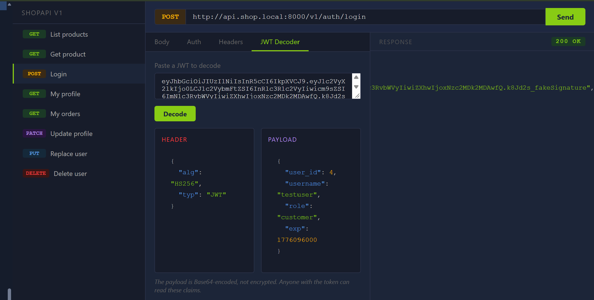
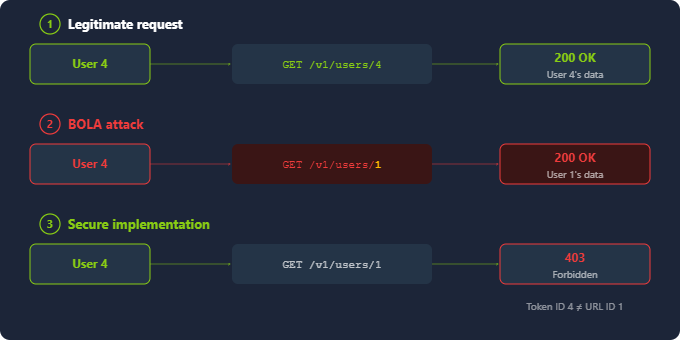

# API Pentesting

Explore how to identify and exploit common API security vulnerabilities.

## Task 1. Introduction

An **API** (Application Programming Interface) is a structured interface that enables software components to communicate with each other. When a user logs into a mobile banking app, scrolls through a social media feed, or places an order on a delivery platform, the client device makes API calls to a back-end server to fetch data, submit information, and trigger actions. Rather than loading full web pages with HTML and styling, APIs typically exchange lightweight data in JSON format. This efficiency and flexibility is why APIs have become the backbone of modern application architecture.

In API-driven architectures, the back-end exposes a set of endpoints that any client can call independently. A single API may serve a web application, a mobile application, and third-party integrations simultaneously. This means the API itself becomes a critical attack surface. If the API is vulnerable, every client that depends on it is affected.

API security testing shares some overlap with traditional web application testing, but introduces a distinct set of challenges. APIs do not have a visible user interface that restricts what a user can do. There are no buttons to click or forms to fill out. An attacker interacts directly with the raw endpoints, meaning they can craft and send any request without being limited by what a front-end application chooses to expose. This directness opens up vulnerability classes that are less common in traditional web testing, such as Broken Object Level Authorization and mass assignment.

In a typical API security engagement, you receive a collection of in-scope endpoints (often as an Insomnia or Postman collection) and test each one for vulnerabilities. You examine how the API handles authentication, whether it enforces proper authorisation on every resource, and whether it exposes more data than necessary in its responses. The goal is to find flaws that an attacker could exploit to access unauthorised data, escalate privileges, or disrupt the service.

### Learning Objectives

By the end of this room, you will be able to:

- Understand the fundamentals of RESTful APIs, including how requests and responses are structured and how authentication is typically handled
- Read and interpret API requests and responses in JSON format
- Identify and exploit common API vulnerabilities outlined in the OWASP API Security Top 10, such as BOLA, Broken Authentication, and Mass Assignment
- Understand how modifying request parameters, headers, and body fields can expose security flaws
- Recognise defensive strategies that protect APIs against the vulnerabilities explored in the room

### Prerequisites

Before starting this room, you should be comfortable with the basics of HTTP, including request methods, headers, and status codes. The following rooms provide the necessary background:

- [HTTP in Detail](https://tryhackme.com/room/httpindetail)
- [OWASP Top 10](https://tryhackme.com/room/owasptopten2025one)

### Questions

I am ready to learn about API pentesting!

> No answer needed

## Task 2. How REST APIs Work

The most common API style in modern web applications is **REST** (Representational State Transfer). REST is not a protocol or a strict standard. It is an architectural style, a set of conventions that developers follow when building APIs over HTTP. An API that follows these conventions is called a **RESTful API**.

### Resources and Endpoints

The core concept in a RESTful API is the **resource**. A resource is any object or piece of data the API exposes, such as a user, a product, or an order. Each resource is identified by a URL, referred to as an **endpoint**. For example, an e-commerce API might expose endpoints like `/v1/users`, `/v1/products`, and `/v1/orders`.

The URL structure is hierarchical. The `/v1` segment indicates the API version. The final segment identifies the resource collection. To refer to a single resource within a collection, an identifier is appended to the path. For example, `/v1/users/42` refers to the user with ID 42.

This predictable structure is a defining characteristic of RESTful APIs. From a security testing perspective, it also makes it straightforward to guess how resources are referenced, which is directly relevant to the authorisation vulnerabilities covered in the next task.

### HTTP Methods

RESTful APIs use standard HTTP methods to define what action should be performed on a resource. Each method maps to a CRUD (Create, Read, Update, Delete) operation.

| Method | CRUD Operation | Description | Example |
| --- | --- | --- | --- |
| `GET` | Read | Retrieves a resource. Should never modify data on the server. | `GET /v1/products/1` returns the data for product 1. |
| `POST` | Create | Creates a new resource or submits data for processing. | `POST /v1/auth/login` with a JSON body authenticates the user and returns a token. |
| `PUT` | Full Update | Replaces an existing resource entirely. Omitted fields may be set to null or a default value. | `PUT /v1/users/4` replaces all of user 4's data with the provided body. |
| `PATCH` | Partial Update | Modifies only the fields included in the request body. Everything else remains unchanged. | `PATCH /v1/users/me` updates only the specified fields. |
| `DELETE` | Delete | Removes a resource from the server. | `DELETE /v1/users/4` deletes user 4. |

The distinction between `PUT` and `PATCH` is worth noting. A `PUT` request expects the full object, while a `PATCH` request expects only the fields that need changing. Some APIs handle validation differently between the two, which is relevant during security testing.

Use the **API Explorer** in the static site to try each method. Select a method and endpoint from the dropdowns, click **Send Request**, and observe the formatted request and response side by side.

### Status Codes

Every API response includes an HTTP status code that indicates what happened with the request. The most relevant codes for API security testing are:

| Code | Meaning | Security Relevance |
| --- | --- | --- |
| `200` | OK | Request succeeded |
| `201` | Created | New resource created (typically after `POST`) |
| `204` | No Content | Success with no response body (typical for `DELETE`) |
| `400` | Bad Request | Malformed request; useful for understanding input validation |
| `401` | Unauthorized | Authentication is missing or invalid |
| `403` | Forbidden | Authenticated but not authorised; key indicator during BOLA testing |
| `404` | Not Found | Resource does not exist |
| `405` | Method Not Allowed | HTTP method not supported for this endpoint |
| `429` | Too Many Requests | Rate limiting in effect |
| `500` | Internal Server Error | Server-side failure; may indicate injection or logic flaws |

The difference between `401` and `403` is particularly important. A `401` means the server does not know who you are. A `403` means the server knows who you are but you are not permitted to access the requested resource. Try the `DELETE /v1/users/4` request in the API Explorer and observe the `403 Forbidden` response.

### Request and Response Structure

A typical API request consists of the HTTP method, the endpoint URL, headers (carrying metadata such as authentication tokens and content type), and optionally a body (carrying the data payload). The vast majority of modern APIs use **JSON** (JavaScript Object Notation) as their data format.

Try the `POST /v1/auth/login` endpoint in the API Explorer. The request includes a JSON body with `username` and `password` fields. The response returns an `access_token` that would be used in subsequent requests via the `Authorization: Bearer <token>` header.

### Authentication Mechanisms

Most APIs require authentication to identify the client making a request. The three most common mechanisms are:

**API Keys**

This is the simplest form of authentication. The client includes a static key in a header (commonly `X-API-Key`). The server looks up the key to identify the client. However, API keys are long-lived, often shared across environments, and if leaked, grant full access until rotated.

**Bearer Tokens**

In this authentication method, the client first authenticates by submitting credentials to a login endpoint, and the server returns a token. The client includes this token in the `Authorization` header of subsequent requests. These tokens are typically short-lived and can be revoked.

**JSON Web Tokens (JWTs)**

This is the most common format for bearer tokens. A JWT consists of three Base64-encoded parts separated by dots: a header (specifying the algorithm), a payload (containing claims such as user ID, role, and expiration), and a signature (ensuring the token has not been tampered with). The payload is not encrypted, only encoded. Anyone with the token can read its contents.

Use the **JWT Decoder** panel in the static site. Copy the `access_token` value from the `POST /v1/auth/login` response, paste it into the decoder, and click **Decode**. Examine the claims in the payload. Note the `user_id`, `role`, and `exp` fields. These claims are central to how the API determines who you are and what you are allowed to do.

### Static Site

Decode the JWT

### Questions

Decode the JWT returned by the login endpoint. What role is assigned to the testuser account?

> customer

## Task 3. Broken Object Level Authorization (BOLA)

**Broken Object Level Authorization (BOLA)** is an authorisation failure that occurs when an API returns a requested object without verifying whether the requesting user is permitted to access it. The API authenticates the user, but does not authorise the request against the specific resource. This concept is also known as Insecure Direct Object Reference (IDOR) in traditional web testing.

### Why BOLA Is the Number One API Risk

BOLA holds the top position in the [OWASP API Security Top 10](https://owasp.org/API-Security/editions/2023/en/0xa1-broken-object-level-authorization/) because it appears in a large number of real-world APIs and frequently leads to mass data exposure. Most API frameworks do not enforce object-level authorisation by default. They handle authentication and routing, but the check of "does this user own this object?" must be implemented manually by the developer in every endpoint. When even one endpoint is missed, a BOLA vulnerability exists.

RESTful APIs reference objects through predictable, structured URLs. A request to `GET /v1/orders/1045` retrieves order 1045. The identifier is directly in the URL and is usually a sequential integer. If the API does not verify ownership before returning the object, any authenticated user can access any other user's data by changing the number.

### How BOLA Works

Consider the following scenario. You are authenticated as user ID 4 (testuser) and request your own order history by sending `GET /v1/users/4/orders`. The server sees a valid token, confirms user 4 exists, and returns your orders. However, if you change the user ID in the URL to `GET /v1/users/1/orders`, you are still authenticating as user 4 but requesting user 1's data.

In a properly secured API, the server would compare the token's user ID against the URL's user ID and return `403 Forbidden`. In a vulnerable API, the server fetches whatever user ID appears in the URL without performing this comparison. The API trusts the URL parameter and goes straight to the database, never verifying whether user 4 should have access to user 1's records.

BOLA is not limited to URL path parameters. It can appear in query strings ( `?owner_id=13`), request body fields (`{"user_id": 13}`), and custom headers (`X-User-ID: 13`). Any location where an object identifier is accepted without validation against the authenticated user is a potential vector.

### Scaling the Attack

Once an attacker confirms a vulnerable endpoint, iterating through all possible object IDs to extract data for every user in the system is trivial. If user IDs are sequential integers, a simple loop from 1 to 1000 pulls the data for every user in seconds. This is why BOLA is not just a theoretical concern. It enables mass data exfiltration with minimal effort.

Some APIs use UUIDs instead of sequential integers. This adds obscurity but is not a security control. UUIDs can be leaked through other endpoints, API responses, or error messages.

### Practical Exercise

Open the **BOLA Simulator** in the static site. You are authenticated as testuser (user ID 4).

The simulator has three panels. The first lets you query user profiles by changing the user ID in a `GET /v1/users/{id}` request. The second lets you query order histories via `GET /v1/users/{id}/orders`. The third lets you attempt a`PATCH` request against another user's profile.

Start by querying your own profile (user ID 4). Then change the user ID to 1 and send the request again. If the API returns user 1's profile data instead of `403 Forbidden`, the BOLA vulnerability is confirmed. Examine the response for sensitive fields that should not be visible to you.

Next, query user 1's order history. Look through the order data for a flag. Finally, test whether BOLA extends to write operations by sending a PATCH request against another user's profile. If the API accepts the modification, the vulnerability is not just information disclosure. It is a data manipulation flaw.