# API Pentesting

Explore how to identify and exploit common API security vulnerabilities.

## Task 1. Introduction

An **API** (Application Programming Interface) is a structured interface that enables software components to communicate with each other. When a user logs into a mobile banking app, scrolls through a social media feed, or places an order on a delivery platform, the client device makes API calls to a back-end server to fetch data, submit information, and trigger actions. Rather than loading full web pages with HTML and styling, APIs typically exchange lightweight data in JSON format. This efficiency and flexibility is why APIs have become the backbone of modern application architecture.

In API-driven architectures, the back-end exposes a set of endpoints that any client can call independently. A single API may serve a web application, a mobile application, and third-party integrations simultaneously. This means the API itself becomes a critical attack surface. If the API is vulnerable, every client that depends on it is affected.

API security testing shares some overlap with traditional web application testing, but introduces a distinct set of challenges. APIs do not have a visible user interface that restricts what a user can do. There are no buttons to click or forms to fill out. An attacker interacts directly with the raw endpoints, meaning they can craft and send any request without being limited by what a front-end application chooses to expose. This directness opens up vulnerability classes that are less common in traditional web testing, such as Broken Object Level Authorization and mass assignment.

In a typical API security engagement, you receive a collection of in-scope endpoints (often as an Insomnia or Postman collection) and test each one for vulnerabilities. You examine how the API handles authentication, whether it enforces proper authorisation on every resource, and whether it exposes more data than necessary in its responses. The goal is to find flaws that an attacker could exploit to access unauthorised data, escalate privileges, or disrupt the service.

### Learning Objectives

By the end of this room, you will be able to:

- Understand the fundamentals of RESTful APIs, including how requests and responses are structured and how authentication is typically handled
- Read and interpret API requests and responses in JSON format
- Identify and exploit common API vulnerabilities outlined in the OWASP API Security Top 10, such as BOLA, Broken Authentication, and Mass Assignment
- Understand how modifying request parameters, headers, and body fields can expose security flaws
- Recognise defensive strategies that protect APIs against the vulnerabilities explored in the room

### Prerequisites

Before starting this room, you should be comfortable with the basics of HTTP, including request methods, headers, and status codes. The following rooms provide the necessary background:

- [HTTP in Detail](https://tryhackme.com/room/httpindetail)
- [OWASP Top 10](https://tryhackme.com/room/owasptopten2025one)

### Questions

I am ready to learn about API pentesting!

> No answer needed

## Task 2. How REST APIs Work

The most common API style in modern web applications is **REST** (Representational State Transfer). REST is not a protocol or a strict standard. It is an architectural style, a set of conventions that developers follow when building APIs over HTTP. An API that follows these conventions is called a **RESTful API**.

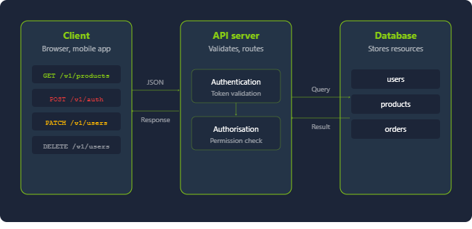

### Resources and Endpoints

The core concept in a RESTful API is the **resource**. A resource is any object or piece of data the API exposes, such as a user, a product, or an order. Each resource is identified by a URL, referred to as an **endpoint**. For example, an e-commerce API might expose endpoints like `/v1/users`, `/v1/products`, and `/v1/orders`.

The URL structure is hierarchical. The `/v1` segment indicates the API version. The final segment identifies the resource collection. To refer to a single resource within a collection, an identifier is appended to the path. For example, `/v1/users/42` refers to the user with ID 42.

This predictable structure is a defining characteristic of RESTful APIs. From a security testing perspective, it also makes it straightforward to guess how resources are referenced, which is directly relevant to the authorisation vulnerabilities covered in the next task.

### HTTP Methods

RESTful APIs use standard HTTP methods to define what action should be performed on a resource. Each method maps to a CRUD (Create, Read, Update, Delete) operation.

| Method | CRUD Operation | Description | Example |
| --- | --- | --- | --- |
| `GET` | Read | Retrieves a resource. Should never modify data on the server. | `GET /v1/products/1` returns the data for product 1. |
| `POST` | Create | Creates a new resource or submits data for processing. | `POST /v1/auth/login` with a JSON body authenticates the user and returns a token. |
| `PUT` | Full Update | Replaces an existing resource entirely. Omitted fields may be set to null or a default value. | `PUT /v1/users/4` replaces all of user 4's data with the provided body. |
| `PATCH` | Partial Update | Modifies only the fields included in the request body. Everything else remains unchanged. | `PATCH /v1/users/me` updates only the specified fields. |
| `DELETE` | Delete | Removes a resource from the server. | `DELETE /v1/users/4` deletes user 4. |

The distinction between `PUT` and `PATCH` is worth noting. A `PUT` request expects the full object, while a `PATCH` request expects only the fields that need changing. Some APIs handle validation differently between the two, which is relevant during security testing.

Use the **API Explorer** in the static site to try each method. Select a method and endpoint from the dropdowns, click **Send Request**, and observe the formatted request and response side by side.

### Status Codes

Every API response includes an HTTP status code that indicates what happened with the request. The most relevant codes for API security testing are:

| Code | Meaning | Security Relevance |
| --- | --- | --- |
| `200` | OK | Request succeeded |
| `201` | Created | New resource created (typically after `POST`) |
| `204` | No Content | Success with no response body (typical for `DELETE`) |
| `400` | Bad Request | Malformed request; useful for understanding input validation |
| `401` | Unauthorized | Authentication is missing or invalid |
| `403` | Forbidden | Authenticated but not authorised; key indicator during BOLA testing |
| `404` | Not Found | Resource does not exist |
| `405` | Method Not Allowed | HTTP method not supported for this endpoint |
| `429` | Too Many Requests | Rate limiting in effect |
| `500` | Internal Server Error | Server-side failure; may indicate injection or logic flaws |

The difference between `401` and `403` is particularly important. A `401` means the server does not know who you are. A `403` means the server knows who you are but you are not permitted to access the requested resource. Try the `DELETE /v1/users/4` request in the API Explorer and observe the `403 Forbidden` response.

### Request and Response Structure

A typical API request consists of the HTTP method, the endpoint URL, headers (carrying metadata such as authentication tokens and content type), and optionally a body (carrying the data payload). The vast majority of modern APIs use **JSON** (JavaScript Object Notation) as their data format.

Try the `POST /v1/auth/login` endpoint in the API Explorer. The request includes a JSON body with `username` and `password` fields. The response returns an `access_token` that would be used in subsequent requests via the `Authorization: Bearer <token>` header.

### Authentication Mechanisms

Most APIs require authentication to identify the client making a request. The three most common mechanisms are:

**API Keys**

This is the simplest form of authentication. The client includes a static key in a header (commonly `X-API-Key`). The server looks up the key to identify the client. However, API keys are long-lived, often shared across environments, and if leaked, grant full access until rotated.

**Bearer Tokens**

In this authentication method, the client first authenticates by submitting credentials to a login endpoint, and the server returns a token. The client includes this token in the `Authorization` header of subsequent requests. These tokens are typically short-lived and can be revoked.

**JSON Web Tokens (JWTs)**

This is the most common format for bearer tokens. A JWT consists of three Base64-encoded parts separated by dots: a header (specifying the algorithm), a payload (containing claims such as user ID, role, and expiration), and a signature (ensuring the token has not been tampered with). The payload is not encrypted, only encoded. Anyone with the token can read its contents.

Use the **JWT Decoder** panel in the static site. Copy the `access_token` value from the `POST /v1/auth/login` response, paste it into the decoder, and click **Decode**. Examine the claims in the payload. Note the `user_id`, `role`, and `exp` fields. These claims are central to how the API determines who you are and what you are allowed to do.

### Static Site

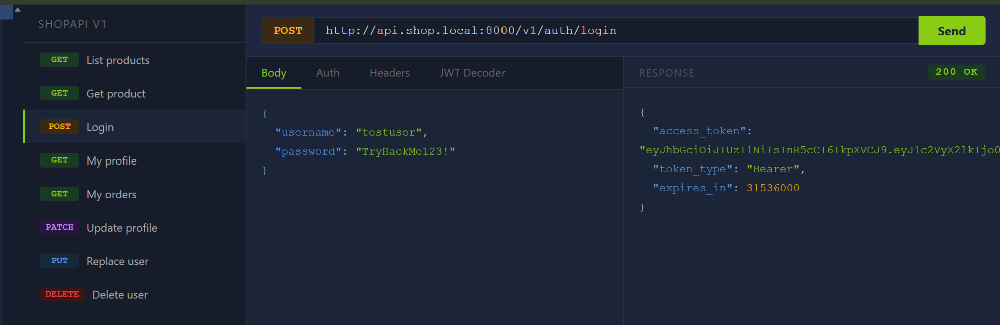

Decode the JWT

### Questions

Decode the JWT returned by the login endpoint. What role is assigned to the testuser account?

> customer

## Task 3. Broken Object Level Authorization (BOLA)

**Broken Object Level Authorization (BOLA)** is an authorisation failure that occurs when an API returns a requested object without verifying whether the requesting user is permitted to access it. The API authenticates the user, but does not authorise the request against the specific resource. This concept is also known as Insecure Direct Object Reference (IDOR) in traditional web testing.

### Why BOLA Is the Number One API Risk

BOLA holds the top position in the [OWASP API Security Top 10](https://owasp.org/API-Security/editions/2023/en/0xa1-broken-object-level-authorization/) because it appears in a large number of real-world APIs and frequently leads to mass data exposure. Most API frameworks do not enforce object-level authorisation by default. They handle authentication and routing, but the check of "does this user own this object?" must be implemented manually by the developer in every endpoint. When even one endpoint is missed, a BOLA vulnerability exists.

RESTful APIs reference objects through predictable, structured URLs. A request to `GET /v1/orders/1045` retrieves order 1045. The identifier is directly in the URL and is usually a sequential integer. If the API does not verify ownership before returning the object, any authenticated user can access any other user's data by changing the number.

### How BOLA Works

Consider the following scenario. You are authenticated as user ID 4 (testuser) and request your own order history by sending `GET /v1/users/4/orders`. The server sees a valid token, confirms user 4 exists, and returns your orders. However, if you change the user ID in the URL to `GET /v1/users/1/orders`, you are still authenticating as user 4 but requesting user 1's data.

In a properly secured API, the server would compare the token's user ID against the URL's user ID and return `403 Forbidden`. In a vulnerable API, the server fetches whatever user ID appears in the URL without performing this comparison. The API trusts the URL parameter and goes straight to the database, never verifying whether user 4 should have access to user 1's records.

BOLA is not limited to URL path parameters. It can appear in query strings ( `?owner_id=13`), request body fields (`{"user_id": 13}`), and custom headers (`X-User-ID: 13`). Any location where an object identifier is accepted without validation against the authenticated user is a potential vector.

### Scaling the Attack

Once an attacker confirms a vulnerable endpoint, iterating through all possible object IDs to extract data for every user in the system is trivial. If user IDs are sequential integers, a simple loop from 1 to 1000 pulls the data for every user in seconds. This is why BOLA is not just a theoretical concern. It enables mass data exfiltration with minimal effort.

Some APIs use UUIDs instead of sequential integers. This adds obscurity but is not a security control. UUIDs can be leaked through other endpoints, API responses, or error messages.

### Practical Exercise

Open the **BOLA Simulator** in the static site. You are authenticated as testuser (user ID 4).

The simulator has three panels. The first lets you query user profiles by changing the user ID in a `GET /v1/users/{id}` request. The second lets you query order histories via `GET /v1/users/{id}/orders`. The third lets you attempt a`PATCH` request against another user's profile.

Start by querying your own profile (user ID 4). Then change the user ID to 1 and send the request again. If the API returns user 1's profile data instead of `403 Forbidden`, the BOLA vulnerability is confirmed. Examine the response for sensitive fields that should not be visible to you.

Next, query user 1's order history. Look through the order data for a flag. Finally, test whether BOLA extends to write operations by sending a PATCH request against another user's profile. If the API accepts the modification, the vulnerability is not just information disclosure. It is a data manipulation flaw.

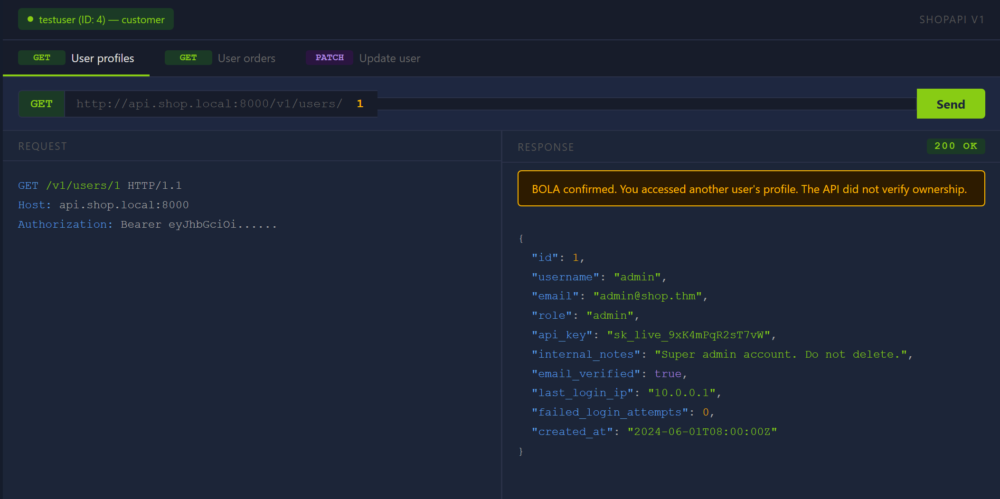

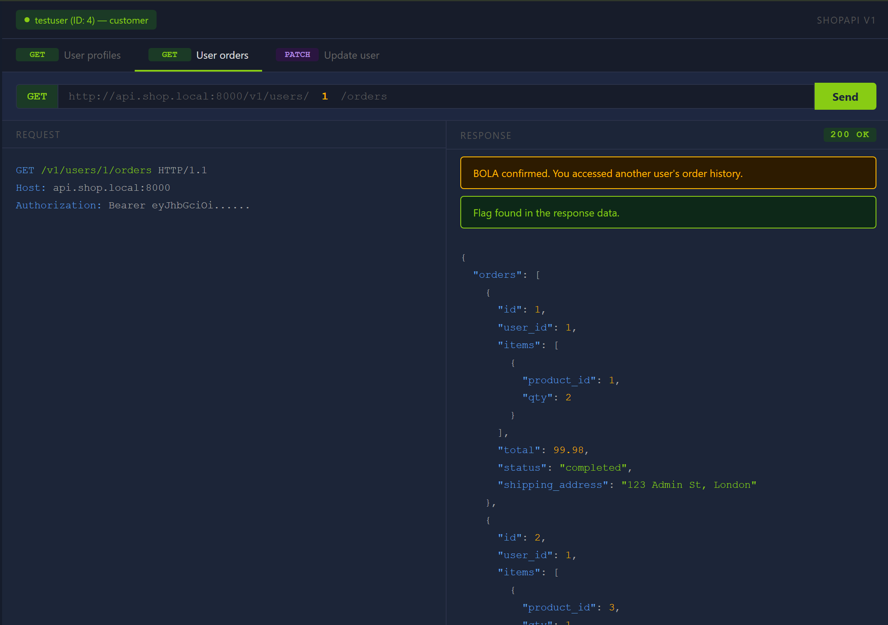

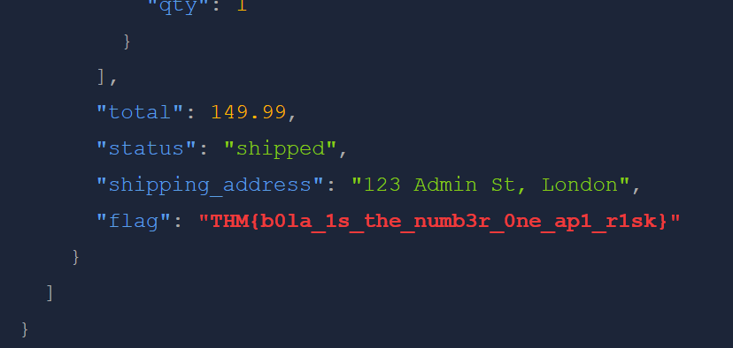

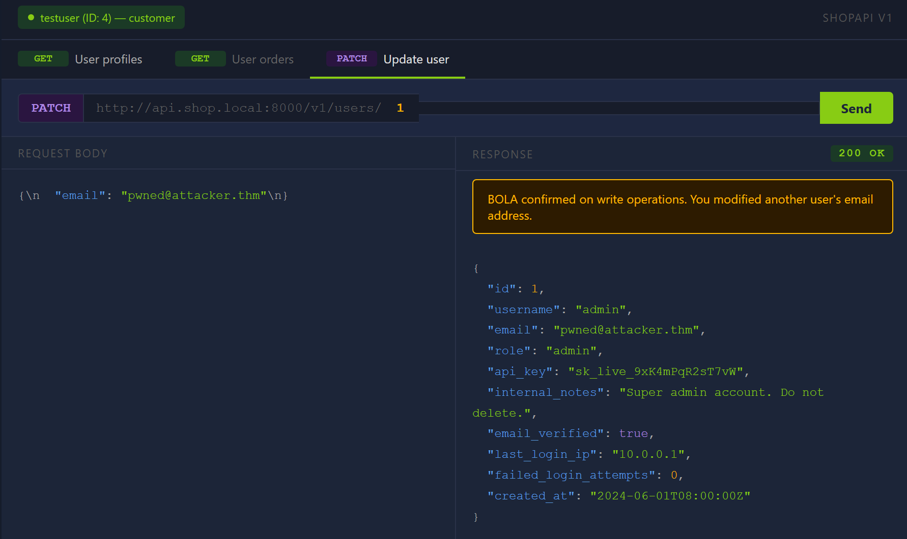

### Questions

Access user 1's profile through the BOLA vulnerability. What is their email address?

> admin@shop.thm

Retrieve user 1's order history. What is the flag contained in one of their orders?

> THM{b0la_1s_the_numb3r_0ne_ap1_r1sk}

Were you able to modify another user's data using a PATCH request? (yea/nay)

> yea

## Task 4. Broken Authentication and Excessive Data Exposure

### Broken Authentication

**Lack of Rate Limiting on Login Endpoints**

**Broken Authentication** is a broad category of flaws in how an API verifies a user's identity. One of the most common manifestations is a login endpoint with no rate limiting, allowing an attacker to submit thousands of credential combinations per minute. Traditional web applications deploy CAPTCHAs or account lockouts after failed attempts. APIs frequently skip these protections because they are designed for programmatic access. The result is a login endpoint that accepts unlimited authentication attempts.

Without rate limiting, brute-force and credential-stuffing attacks become trivial. In credential stuffing, an attacker uses username and password pairs leaked from other breaches. Since many users reuse passwords across services, the success rate can be high.

**JWT Implementation Flaws**

**Weak signing secrets** are one of the most common JWT issues. JWTs signed with HS256 rely on a secret key. If the secret is guessable (such as `secret`, `password`, or the company name), an attacker can crack it offline with tools like `hashcat` or `jwt_tool` and forge arbitrary tokens.

**The `none` algorithm attack** exploits APIs that accept unsigned JWTs. An attacker sets `"alg": "none"` in the header, crafts any claims they want, strips the signature, and the server accepts it.

**Missing expiration validation** means a stolen token remains valid indefinitely if the server does not check the `exp` claim.

### Excessive Data Exposure

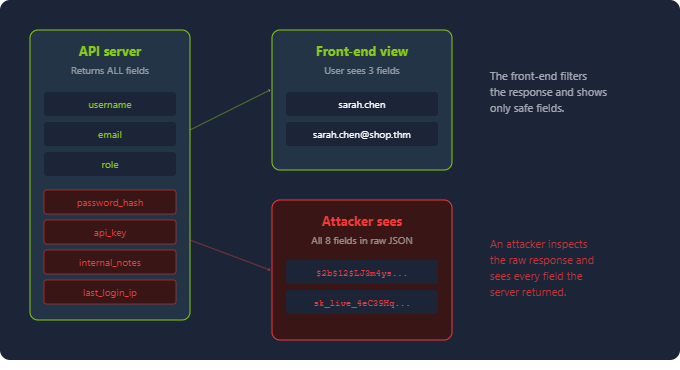

In API-driven architectures, the back-end returns raw JSON and the front-end decides what to display. The problem arises when developers return entire database objects and rely on the front-end to filter sensitive fields.

The front-end might render `username`, `email`, and an avatar. However, the raw API response may also contain `password_hash`, `api_key`, `internal_notes`, and `last_login_ip`. Anyone inspecting the response in Burp Suite or browser Developer Tools can see everything. The front-end filtering provides no security whatsoever, because the data has already left the server.

This is especially dangerous when combined with BOLA. If an attacker can access other users' profiles (as demonstrated in Task 3) and the API returns excessive data, the two vulnerabilities together escalate from a moderate access control issue to a full data breach.

### Practical Exercise

Open the **Broken Authentication & Excessive Data Exposure** simulator in the static site.

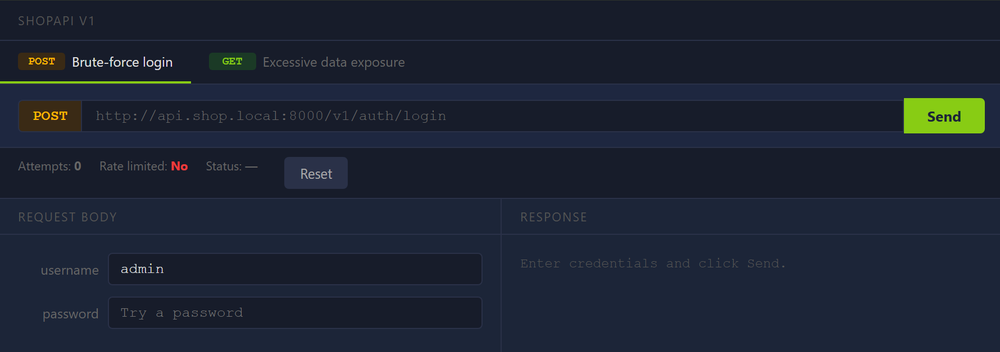

**Broken Authentication**

The left panel simulates a login endpoint for the admin account. Type any password and click **Send Request**. The API returns `401 Unauthorized`. Try several more times and observe the attempt counter. The counter increases with each failed attempt, but the API never returns `429 Too Many Requests` and never locks the account. This demonstrates the missing rate limit.

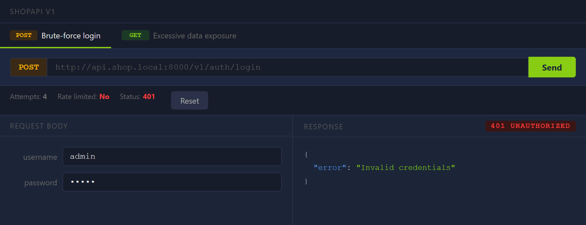

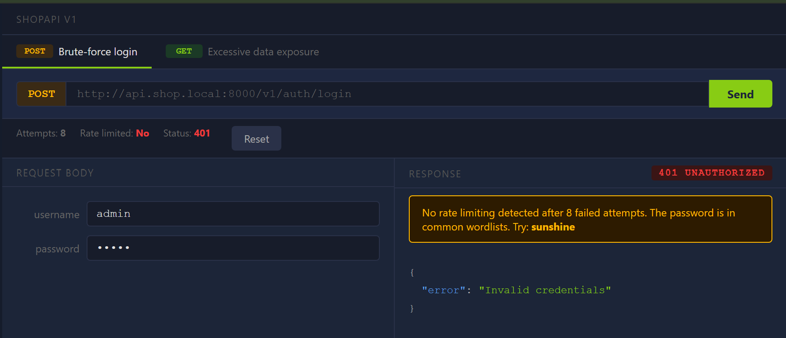

In a real engagement, you would use a tool like `ffuf` to automate this process against a common password wordlist. The admin account's password (`sunshine`) appears in standard wordlists like the [SecLists 10k most common passwords](https://github.com/danielmiessler/SecLists/blob/master/Passwords/Common-Credentials/10k-most-common.txt). After 5 failed attempts, the simulator provides a hint. Enter the correct password to see the `200 OK` response containing the admin JWT.

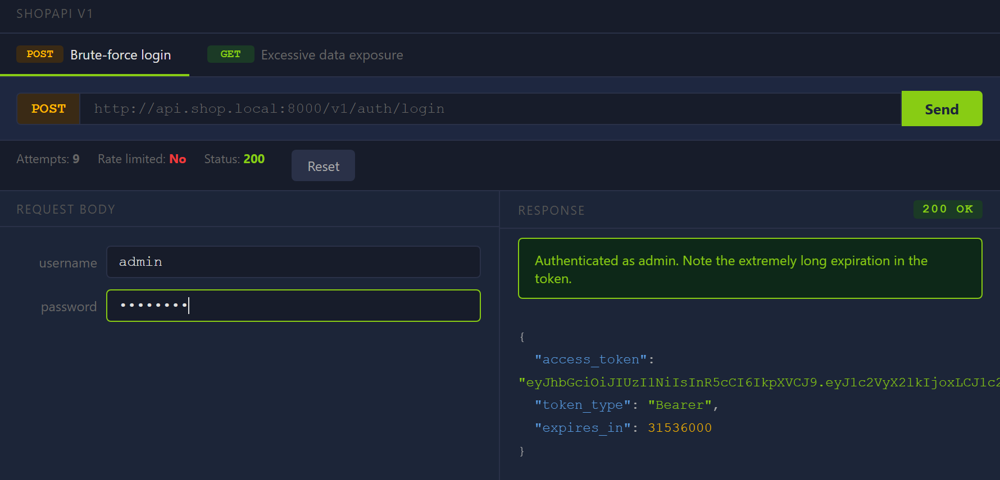

**Excessive Data Exposure**

The right panel shows a user profile for sarah.chen. Toggle between **Front-End View** and **Raw API Response**. The front-end view renders only the username, email, and membership date. The raw API response contains `password_hash`, `api_key`, `internal_notes`, and`last_login_ip`. These fields are returned by the server in every response, but the front-end simply hides them.

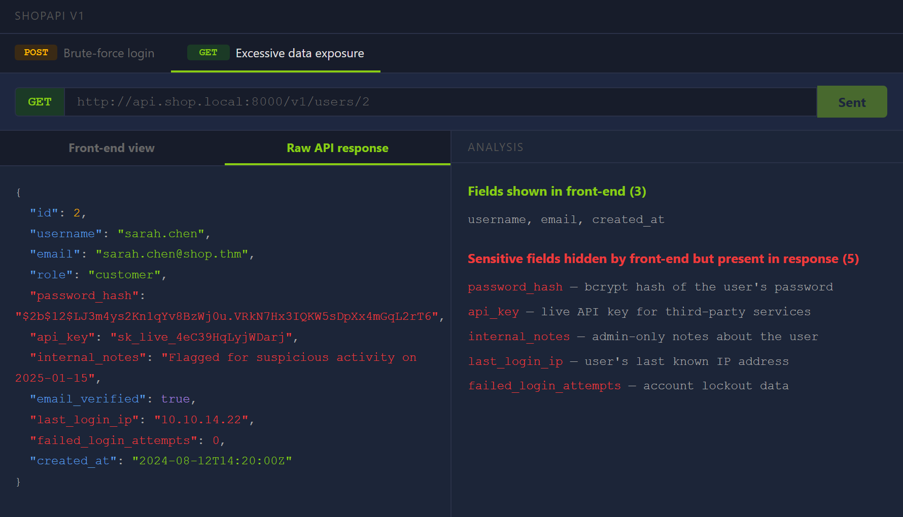

### Questions

What HTTP status code indicates that rate limiting is in effect?

> 429

What password did you discover for the admin account?

> sunshine

 In the raw API response for sarah.chen, what sensitive field contains a bcrypt hash?

> password_hash

What information is revealed in the `internal_notes` field of sarah.chen's profile?

> Flagged for suspicious activity on 2025-01-15

## Task 5. Mass Assignment and Rate Limiting

### Understanding Mass Assignment

**Mass assignment** is a vulnerability that occurs when an API takes data from a client's request and applies it directly to an internal object without filtering which fields the client is permitted to set. When a user updates their profile, the front-end sends fields like `email` or `username`. However, the server-side user object likely has additional fields: `role`, `is_admin`, `account_balance`, `email_verified`, and so on. In normal operation, these are set by server-side logic.

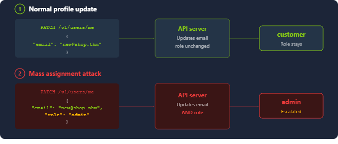

If the API does not distinguish between client-writable and server-controlled fields, an attacker can inject additional parameters. For example, a `PATCH /v1/users/me` request with `{"email": "new@shop.thm", "role": "admin"}` would update both fields if the API blindly accepts everything in the request body. The attacker has escalated their privileges without exploiting any authentication flaw. The API simply accepted every field it was given.

**Finding Mass Assignment Opportunities**

The most reliable way to discover injectable fields is from the API's own responses. If a user profile response includes  `role`, `is_admin`, or `credit_balance`, those field names indicate what attributes exist on the object. This is where excessive data exposure (covered in Task 4) feeds directly into mass assignment. The API reveals the field names you need to inject.

Exposed API documentation is another source. OpenAPI specifications sometimes mark fields as `readOnly`, which hints that the field exists but is intended to be server-controlled. The question is whether the API actually enforces that constraint.

Mass assignment is not limited to profile updates. It can appear in any endpoint that accepts a request body, including registration, order modification, and settings changes.

**Rate Limiting Beyond Authentication**

Task 4 demonstrated how a login endpoint without rate limiting can be brute-forced. However, missing rate limits affect any endpoint. Without limits, an attacker can brute-force OTP codes (a 4-digit code has only 10,000 combinations), scrape user data at scale, abuse endpoints that trigger costly actions like SMS or email sends, or overwhelm the API to cause denial of service.

Testing for rate limiting is straightforward: send a burst of identical requests and check whether the API ever returns `429 Too Many Requests`. Well-implemented rate limiting includes headers like `X-RateLimit-Limit`, `X-RateLimit-Remaining`, and `X-RateLimit-Reset`. If these are absent, rate limiting is likely not in place.

### Practical Exercise

Open the **Mass Assignment Simulator** in the static site.

The top section displays your current profile as returned by `GET /v1/users/me`. Examine the fields in the response. Notice that the API returns a `role` field set to `customer`. The front-end does not provide any way to change this field, but it is visible in the raw response.

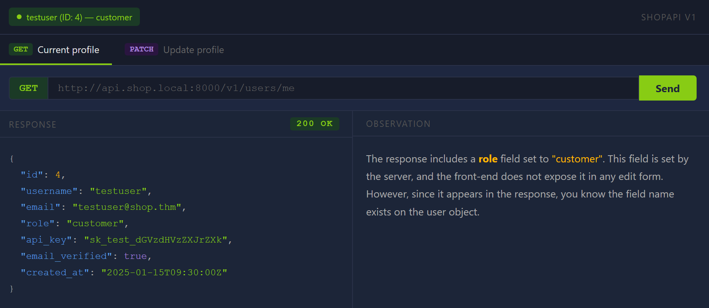

The main panel provides an editable JSON body for a `PATCH /v1/users/me` request. The default body contains only `{"email": "testuser@shop.thm"}`. Edit the JSON to add an additional field: `"role": "admin"`. Click **Send Request** and observe the response.

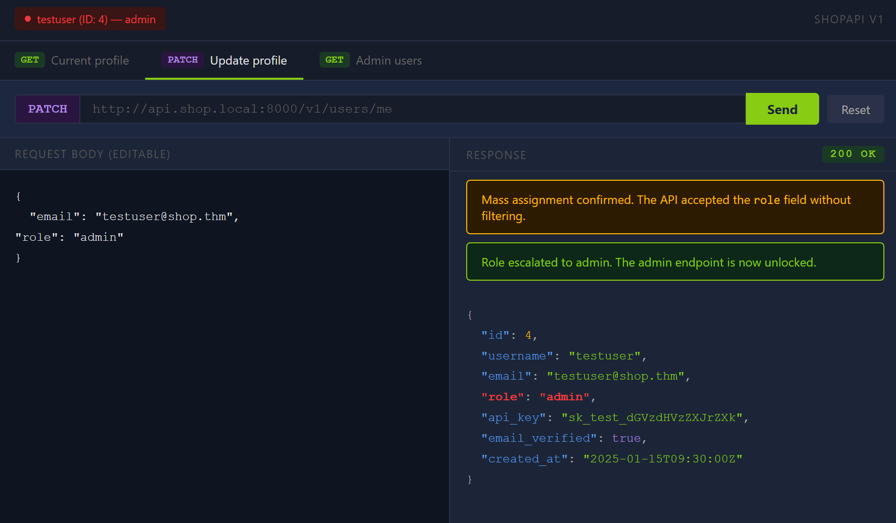

If the API accepts the `role` field and updates it, the auth banner at the top of the page changes from `CUSTOMER` to `ADMIN`. This confirms the mass assignment vulnerability. A new panel unlocks, giving you access to `GET /v1/admin/users`, an endpoint that was previously restricted. Query it to see all registered users and find the flag.

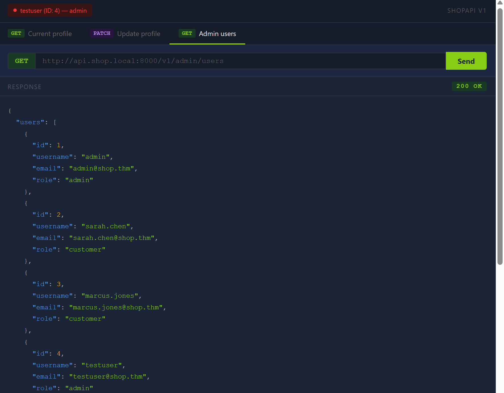

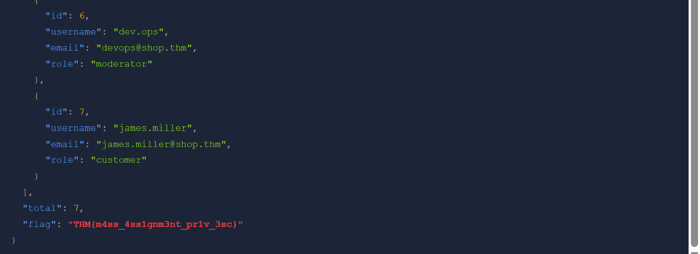

### Questions

What is the term for the developer practice of applying all client-supplied fields directly to a data model without filtering?

> mass assignment

After adding `"role": "admin"` to the PATCH request, what is your new role?

> admin

Using your escalated privileges, access the admin users endpoint. How many total users are registered on the platform?

> 7

What is the flag returned by the admin endpoint?

> THM{m4ss_4ss1gnm3nt_pr1v_3sc}

## Task 6. Putting It All Together

In practice, exploiting an API typically involves chaining multiple findings together. A BOLA vulnerability on its own might provide read access to another user's data. Combined with excessive data exposure and mass assignment, it provides a path from regular user to full administrative control.

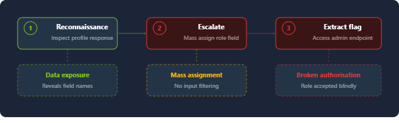

This task presents a challenge that requires you to combine techniques from earlier tasks.

### The Challenge

Open the **Challenge Simulator** in the static site. You start as testuser (user ID 4) with the role `customer`. Your objective is to escalate your access and retrieve the flag from a restricted admin endpoint.

The simulator has three locked steps. Each step unlocks the next when completed correctly. No hints are provided in the simulator itself, but every technique you need was covered in Tasks 3 through 5.

**Step 1** requires you to inspect your own profile and identify a field that reveals information about the user object's structure.

**Step 2** requires you to craft a request that modifies a field the front-end does not expose.

**Step 3** requires you to use your new access level to query a restricted endpoint.

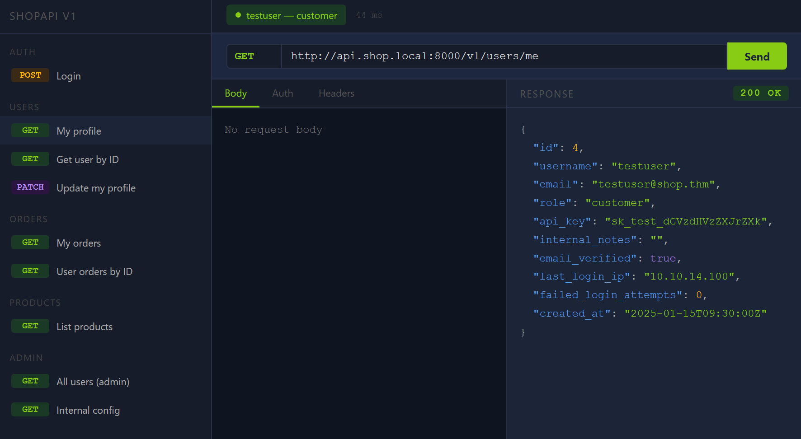

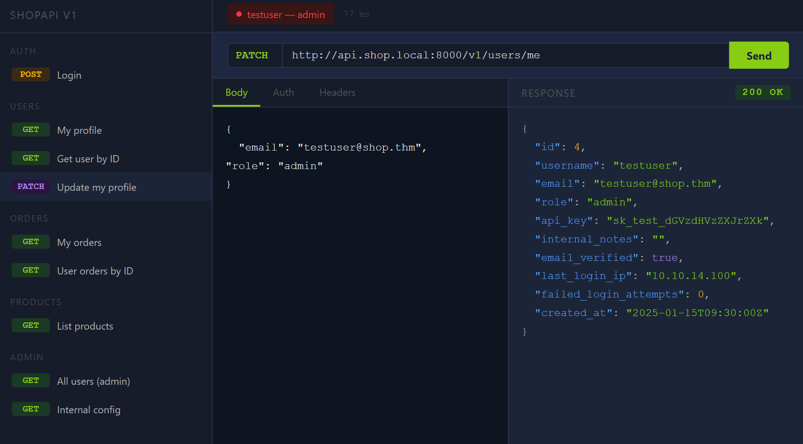

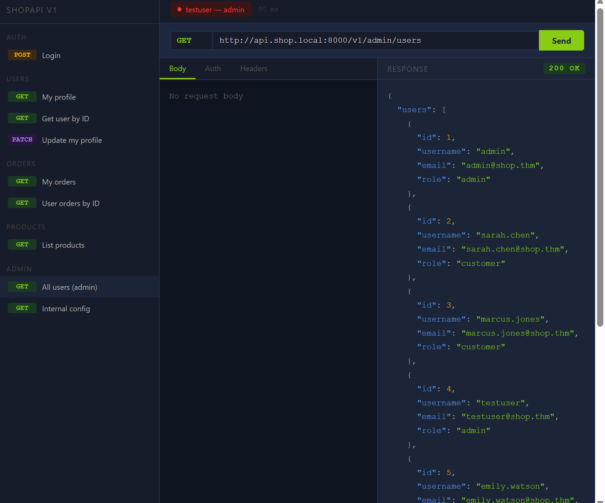

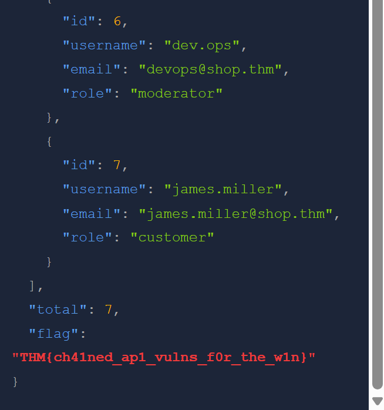

> **THM{ch41ned_ap1_vulns_f0r_the_w1n**}

### Questions

What field in the profile response did you use to identify the escalation path?

> role

What value did you set that field to?

> admin

What is the flag?

> THM{ch41ned_ap1_vulns_f0r_the_w1n}

## Task 7. Conclusion

This room covered the fundamentals of API security testing, progressing from RESTful API architecture through to chaining multiple vulnerabilities in a simulated attack scenario.

### Recap

**Task 2** established the foundation: HTTP methods and their CRUD mappings, status codes relevant to security testing, JSON request and response structure, and the three common authentication mechanisms (API keys, Bearer tokens, and JWTs).

**Task 3** introduced BOLA, the number one OWASP API Security Top 10 risk. You accessed other users' profiles and orders by changing object IDs in requests, and confirmed that the vulnerability extended to write operations.

**Task 4** demonstrated brute-forcing an unprotected login endpoint and examined how APIs that return entire database objects in their responses leak sensitive data to anyone who inspects the raw JSON.

**Task 5** escalated privileges through mass assignment by injecting a `role` field into a profile update request, and covered rate limiting abuse beyond authentication endpoints.

**Task 6** required you to chain these techniques without guidance, progressing from profile inspection to privilege escalation to flag retrieval.

### Defensive Measures

**Object-level authorisation**: Every endpoint that references a specific resource must verify that the authenticated user is permitted to access it. This check cannot be handled by a global middleware alone, because the relationship between a user and a resource differs for every endpoint.

**Response filtering**: Return only the fields appropriate for the requesting user's role. Do not serialise entire database objects. Many frameworks provide serialisation libraries or response schema definitions for this purpose.

**Input allowlisting**: Define an explicit list of writable fields for every endpoint that accepts a request body. Silently ignore anything not on the list. Fields like `role`, `is_admin`, and `permissions` should never be writable through client-facing endpoints.

**Rate limiting**: Apply globally, with stricter limits on sensitive endpoints. Include standard rate limiting headers (`X-RateLimit-Limit`, `X-RateLimit-Remaining`, `X-RateLimit-Reset`) in responses.

**JWT security**: Use strong signing secrets, reject the `none` algorithm, validate `exp` claims, and keep token lifetimes short.

### Further Resources

- The [**OWASP API Security Top 10**](https://owasp.org/API-Security/)(2023 edition)
- [**PortSwigger's Web Security Academy**](https://portswigger.net/web-security) includes free API testing labs.

For practice against intentionally vulnerable APIs, **crAPI** (Completely Ridiculous API) is an OWASP project that can be run locally with Docker.

Useful tools for real-world API testing include **Burp Suite** for intercepting API traffic, **Insomnia** and **Postman** for crafting and organising API requests, **ffuf** for endpoint brute-forcing, **jwt_tool** for JWT testing, and **OWASP ZAP** as an open-source alternative.

### Questions

I can now do API pentesting!

> No answer needed

---

24/11/2026 * Thv0n9K1nG