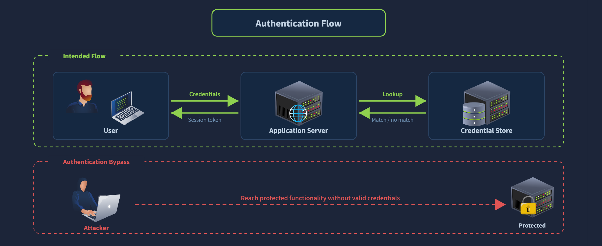
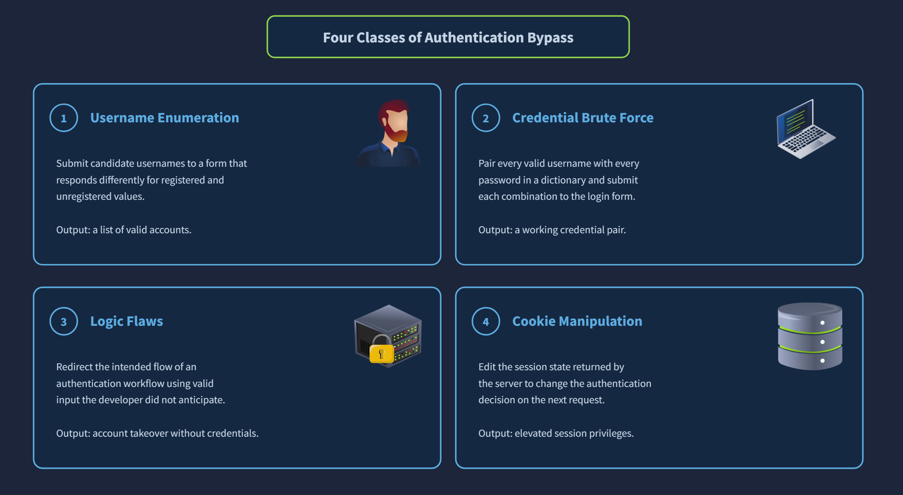

# Broken Authentication

Learn how to defeat logins and other authentication mechanisms to allow you access to unpermitted areas.

## Task 1. Introduction

Authentication is the process by which a web application verifies the identity of the user making a request. It typically takes place at the application server, which compares the credentials submitted by the client against records held in a credential store. When the credentials match, the server issues a session token that is returned on every subsequent request until the session expires, and the application uses that token to decide what the request is allowed to do.

An authentication bypass is any attack that allows a user to reach functionality restricted to a given account without supplying the correct credential for that account. Bypass attacks do not always require guessing a password or stealing a session token. Many succeed by exploiting assumptions the developer made about how the authentication process would be used, or by modifying data that the server trusts without independent verification.

### Target Environment

Start the machine using the button at the top of this task and wait for the IP address to appear in the banner before continuing. Every tool used in the room is pre-installed on the AttackBox, which can be launched with the green button at the top of the screen.

### Learning Objectives

By the end of this room, you will be able to:

- Enumerate valid usernames from differences in a signup form's response using `ffuf`
- Brute-force a login form with a custom username list and a password wordlist
- Identify and exploit a parameter pollution flaw in a password reset workflow with `curl`
- Modify plain text, hashed, and base64-encoded cookies to change the authenticated state the server sees

## Task 2. Types of Authentication Bypass

Many types of flaw can lead to an authentication bypass. The most common, however, are a group of four techniques that appear repeatedly in real-world testing: username enumeration, credential brute force, logic flaws in account recovery, and cookie manipulation. Each targets a different component of the authentication stack, and each requires a different approach to detect and exploit.

Username enumeration is used to produce a list of accounts registered on the target application. This is done by submitting candidate usernames to a form that responds differently for registered and unregistered values, such as a signup or password reset page. The output is a short list of real accounts, which feeds directly into the credential attacks that follow.

Credential brute force uses that list together with a dictionary of common passwords to find accounts whose passwords can be guessed. In the most basic case, the attacker pairs every username with every password in the dictionary and submits each combination to the login form. When the application does not apply rate limits or lockouts, the attack is inexpensive to run and frequently produces a working credential pair within seconds.

Logic flaws occur when the intended flow of an authentication-related workflow can be redirected by valid-looking input. Password reset and account recovery workflows are a frequent source of such flaws, because they commonly split input across multiple HTTP parameters, cookies, and session variables. A mistake in how those inputs are combined can allow the reset link for one account to be delivered to a different address than the one on file.

Cookie manipulation targets the session state that the server returns to the client after a successful login. Cookies that are not cryptographically signed can be edited by the client to change the authentication decision the server makes on subsequent requests. Common formats are plain text cookies, cookies containing a hash of an underlying value, and cookies containing a reversibly encoded payload such as base64.

### Use Cases and Impact

The outcome of a successful authentication bypass depends on the account the attacker is able to reach and on the privileges granted to that account.

First, an attacker may use a bypass to access the data and functionality belonging to a particular user. For a regular customer account, this typically includes personal information, transaction history, and any records associated with the user. For an administrator account, the same technique provides control over the application itself, including the ability to modify other users' data, read the contents of the underlying database, or change the application's configuration.

A bypass is also commonly used as the first step in a longer attack. A valid session for a support agent, for example, can be used to read support tickets belonging to every customer of the application. Access to an administrative account can, in some cases, lead to execution of arbitrary code on the underlying server through features available to that privilege level, such as file upload or script evaluation.

Credentials recovered through a bypass are often reused against unrelated applications. Users frequently share passwords across services, so a password disclosed on one site can grant access to accounts on others. This pattern is known as credential stuffing and accounts for a large proportion of account compromise reported on consumer applications today.

### Questions

What is the name for the practice of reusing credentials recovered from one application against unrelated applications?

> credential reuse

## Task 3. Username Enumeration

Username enumeration is a reconnaissance technique used to determine which usernames exist on a target web application. The output is a list of real accounts that can be fed into credential attacks such as brute force, password spraying, and targeted phishing. Before any meaningful attack on user accounts can be mounted, the attacker needs to know which accounts exist, and an application that discloses this information removes the first step the attacker would otherwise have to complete.

There are many places in a typical web application where this information can leak. A signup form that refuses to register a duplicate username, a login form that distinguishes between an unknown account and a bad password, and a password reset form that reports whether an email address is on file are all candidates for enumeration. In each case, the application handles registered and unregistered values differently and, in doing so, reveals which values are which.

### Error Message Differentials

The most common enumeration vector is a signup form that rejects duplicate usernames. When a user attempts to register with a name that is already in use, the application returns an error such as "An account with this username already exists." The same form accepts a name that has never been registered and responds with a success message. The difference between the two responses is easy to distinguish programmatically, and that difference is the basis for automated enumeration.

Error messages are not the only signal. Two responses may contain the same visible text while differing in length, status code, response time, or redirect behaviour. A well-designed tool can match against any of these properties, which means an application returning identical error messages may still be enumerable if its underlying responses differ in some other respect.

The Acme IT Support signup page at `http://10.49.146.188/customers/signup` is vulnerable to this pattern. A `POST` request containing `username=admin` with arbitrary values in the remaining fields returns the message "An account with this username already exists." A request with a username that has never been registered returns a different response, and the body of that response is the signal an automated tool can filter against.

